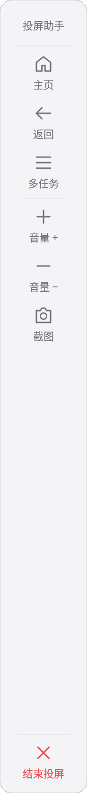
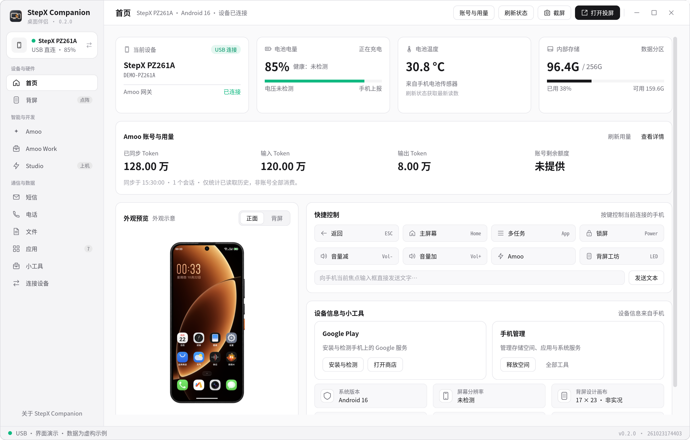
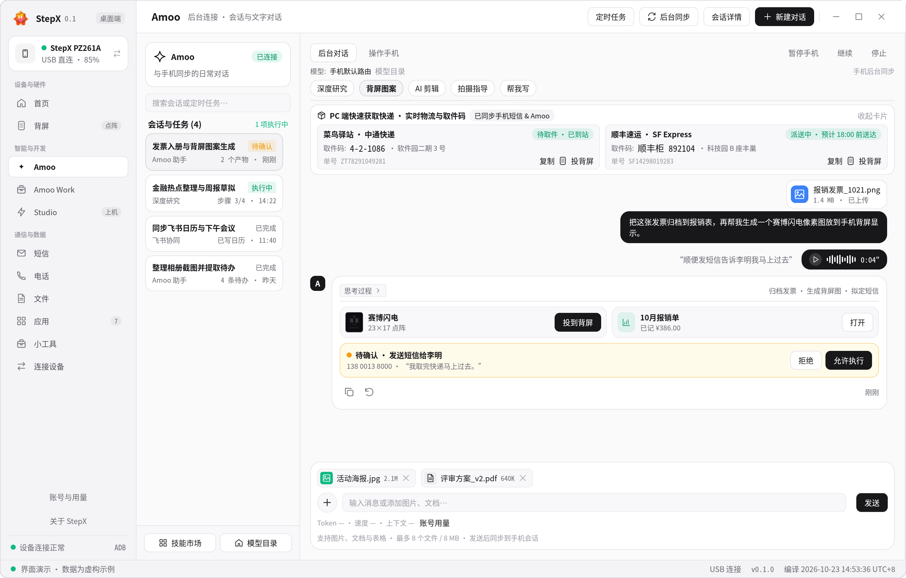
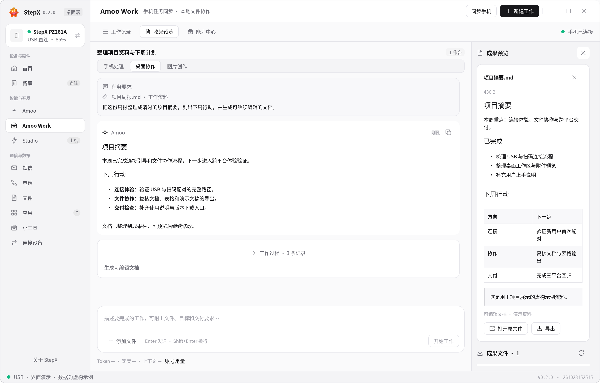
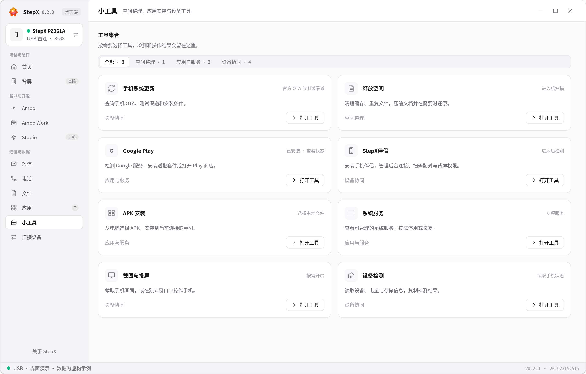
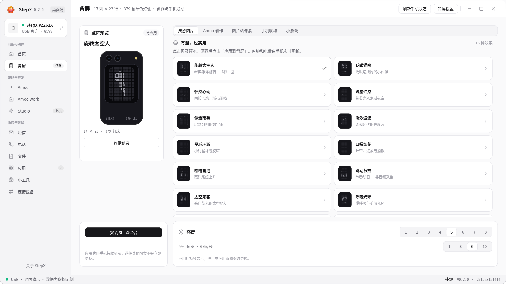
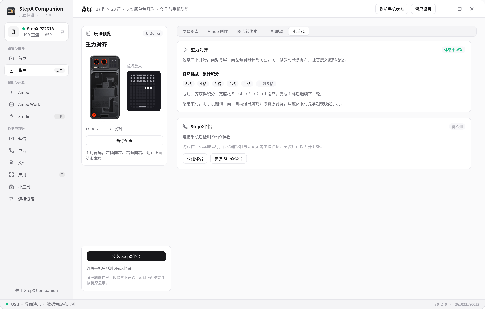

<div align="center">


# StepX Companion · STEPX Neo 手机的桌面伴侣

**把 STEPX Neo 变成电脑上的工作伙伴：压缩手机空间、直接聊 Amoo、用手机 Token 做 Work、安装 Google Play，还能设置背屏、玩体感游戏。投屏控制、文件互传与应用管理，也在一个工作台完成。**

面向阶跃星辰 STEPX Neo 手机 · 当前适配 PZ261A

Linux / macOS / Windows · Rust 原生客户端 · 配套 StepX伴侣 Android 服务

[下载安装](https://github.com/xydzf520/stepx/releases/latest) · [快速开始](docs/GETTING_STARTED.md) · [构建指南](docs/BUILDING.md) · [反馈问题](https://github.com/xydzf520/stepx/issues)

</div>

**这是给谁用的？** 已有 [STEPX Neo](https://www.stepx.com/) 手机，希望在电脑上使用 Amoo、处理工作资料、安装 Google Play，并管理手机空间的用户。本项目围绕 **PZ261A / Step AOS** 适配，是社区开发的第三方桌面客户端，与 STEPX、Amoo、Google 无官方隶属关系。

## 特色功能

- **压缩与释放手机空间**：在手机本地压缩适合压缩的文档、清理缓存和重复文件，查看处理结果，并按需还原压缩文件。
- **电脑直接聊 Amoo**：沿用手机已有的 Amoo 账号，继续手机会话，发送文字、文件和图片，查看定时任务。
- **把 Amoo 变成工作台**：通过 Amoo Work 调用手机模型，结合电脑上的资料和文件执行能力，写文档、做 PPT、分析表格、生成图片并预览成果。
- **用上手机已有的百亿 Token 权益**：对已开通购机 Token 权益的账号，Amoo 与 Work 沿用手机服务和原有计量规则；权益额度、有效期和可用模型以实际手机账号为准。桌面客户端本身不额外赠送额度。
- **安装 Google Play**：在适配固件上安装 Google Play 及必要组件，配合安装前检查、兼容性诊断和 StepX伴侣安装流程。
- **在电脑上设置背屏**：挑选像素图案与动画，将图片转成点阵，调整亮度、速度与播放时长，预览后应用到手机；也能让 Amoo 按描述生成背屏内容。
- **用背屏打体感游戏**：三敲进入「重力对齐」，左右倾斜手机接住下落长条，5 格到 1 格循环挑战、累计积分；翻到手机正面即可退出，安装伴侣后可脱离电脑游玩。

Amoo / Work 的手机模型任务使用手机账号服务；独立 GUI Agent 可选外部模型，需要另行配置。Google 安装需准备匹配的安装包，公开发行版不分发 Google APK。

## 常用能力

| 能力 | 使用体验 |
| --- | --- |
| **投屏与控制** | USB / 无线查看手机画面，鼠标与键盘操作；跟随画面窗口的竖排侧栏，提供主页、返回、多任务、音量、截图和结束投屏；随窗口移动、缩放和最小化。 |
| **文件互传** | 浏览手机目录，上传、下载、新建目录、重命名和删除；图片、音乐等目录有清晰的类型图标。 |
| **应用管理** | 读取真实应用名称与图标，查看安装列表，安装、导出 APK 和卸载应用。 |
| **短信与电话** | 读取真实短信、联系人及通话记录，从桌面发起手机拨号或短信操作；可用功能以设备授权为准。 |
| **设备状态** | 首页查看电池、温度、存储与 Amoo 可获取的 Token 用量；USB 连接、无线配对及首次 ADB 引导集中管理。 |

空闲时按需加载模块：离开背屏即暂停桌面预览，已开始的手机任务继续运行。[性能与响应性验证](docs/PERFORMANCE.md)

客户端只运行一个实例：再次打开会唤起已有窗口；最小化后可直接从启动器恢复。异常退出后可以正常重新启动。

### 投屏助手：控制就在画面旁



从「小工具 → 截图与投屏」开启后，在独立窗口查看并操作手机。**竖排侧栏贴着投屏画面显示**，主界面只保留投屏入口，桌面空间留给手机内容。

- **主页、返回、多任务**：直接操作手机系统导航。
- **音量增减**：快捷调整手机音量。
- **截图**：截取手机当前画面，在客户端预览并另存。
- **结束投屏**：底部关闭按钮结束本次投屏，画面与侧栏一起退出。
- **跟随窗口**：拖动、缩放、最小化和恢复投屏窗口时，侧栏同步跟随；关闭画面窗口也会收起侧栏。

投屏期间保持手机活跃，结束后恢复手机自动息屏行为。锁屏状态下，涉及手机界面的操作仍需本人解锁。

*右图为应用实际渲染的控制侧栏；下面各页截图使用虚构演示数据。*

<br clear="right" />


## 桌面首页：手机状态与账号用量



*界面截图由应用自身渲染，使用虚构演示数据；不包含真实账号或手机记录。*

| 模块 | 你能做什么 |
| --- | --- |
| **Amoo** | 在电脑与手机 Amoo 对话，同步会话与附件，查看定时任务、模型和可获取的用量信息。 |
| **Amoo Work** | 复用手机模型和账号权益，在电脑处理文档、表格、PPT 和图片，查看过程并预览成果。 |
| **空间压缩与清理** | 在手机上压缩文档、识别重复文件和清理缓存，减少手机存储占用。 |
| **背屏设置** | 图案与动画、图片转像素、亮度、速度、时长及亮屏方式，先预览再应用到手机。 |
| **背屏游戏** | 三敲启动「重力对齐」，倾斜控制长条、循环闯关与累计积分，翻面退出。 |
| **小工具箱** | 集中处理空间释放、手机 OTA 检查、投屏、APK 安装、Google 服务与 StepX伴侣安装引导。 |
| **设备管理** | 查看电池、温度与存储，管理短信、电话、文件和已安装应用。 |
| **StepX伴侣** | 手机上的扫码连接、文件互传、后台服务和实验性 GUI Agent 控制入口。 |

## Amoo：继续手机上的对话



- **同一部手机，同一组会话**：通过手机的 Amoo 接口读取和发送对话；支持后台连接与同步状态提示。
- **正文好读，过程可查**：Markdown 格式化显示，工具执行记录折叠展示，支持复制、重试和附件操作。
- **附件真正进入任务**：文件与图片上传、图片分析及图片结果预览；本地缓存已成功下载的附件，减少短期链接失效影响。
- **定时任务有入口**：查看手机返回的定时任务及执行信息，集中管理日常安排。
- **模型与用量透明**：展示接口可返回的模型、上下文、输入输出 token 和速度；不可获取的信息标为未知，不把本地估算当账号账单。

Amoo 使用手机现有账号与官方服务。账号权限、模型路由、付费额度和手机安全确认仍由原服务决定。熄屏下的后台处理不代表可以绕过系统锁屏完成界面操作。

## Amoo Work：从对话走向交付



工作区将**任务记录、输入资料、执行过程和成果预览**放在一起。手机处理适合调用手机模型与技能；桌面协作模式在用户选择的工作目录中完成文件任务；图片创作展示生成结果与附件。

- 拖入或添加资料，围绕文件继续对话。
- 分析表格，生成可编辑文档、工作簿与演示文稿。
- 在侧栏预览图片、文本和交付文件，并打开或另存结果。
- 将重复执行记录收起，让最终结果更容易找到。
- 支持手机能力目录中的模型、技能、智能体和 AI 应用；实际可用范围由手机接口与账号授权决定。

桌面协作涉及本地文件操作，请选择专门的工作目录。输出结果需要按任务用途复核。

## 空间压缩：让手机腾出更多空间

从「小工具 → 释放空间」扫描手机存储，查看可压缩文档、重复文件和可清理项目，再按需要选择处理。

- **文件留在手机**：对适合压缩的文档在手机上生成压缩文件，校验成功且确实节省空间后才替换原文件。
- **需要时可还原**：保留压缩文件的还原路径，处理前后展示结果；没有压缩收益时保留原文件。
- **清理与压缩分开选择**：重复文件、缓存和压缩操作分别展示，用户核对后执行。
- **按机型检测能力**：系统级透明压缩取决于内核和数据分区支持，检测结果不代表所有应用数据都能压缩。

压缩收益取决于文件内容。照片、视频及已压缩文件通常空间有限；本功能当前主要面向可压缩文档与可清理项目。

## 小工具：常用能力，一个入口



| 工具 | 说明 |
| --- | --- |
| **释放空间** | 检查可清理内容并提供清理操作，以释放手机空间为目标；删除前应核对选项。 |
| **检查更新** | 查询手机 OTA 服务与版本信息。发现包不代表该包适合当前设备，安装仍需匹配机型、渠道和版本。 |
| **手机投屏** | 基于 scrcpy 的手机画面与控制，官方桌面工具随发布包提供。 |
| **APK 与应用** | 安装应用、读取应用信息，并提供导出和卸载等管理操作。 |
| **StepX伴侣安装** | 安装配套 Android 应用，引导完成所需权限、后台服务与扫码配对。 |
| **Google Play 安装** | 在适配固件上安装 Play 商店及必要 Google 组件，检查安装状态与兼容性。需准备匹配安装包；安装成功不等于通过设备认证。 |
| **设备与系统服务** | 查看设备信息、权限与服务状态；高级操作受设备能力和授权限制。 |

## 背屏设置：把手机背面变成你的像素画布



在电脑上管理 STEPX Neo 的 **17 × 23 点阵、379 颗灯珠**。从「背屏」挑选内容，先看桌面预览，再点击 **应用到背屏**，让手机真正显示出来。

| 可以设置什么 | 使用方式 |
| --- | --- |
| **图案与动画** | 太空人、心跳、像素雨幕、星球、咖啡等预设，选择后预览，再应用到手机。 |
| **图片转像素** | 导入喜欢的图片，转换为适合背屏的单色点阵；也能通过 Amoo 描述并生成新内容。 |
| **亮度与播放** | 调整亮度、动画速度和持续时间，选择自动亮屏、常亮或沿用手机设定的时段。 |
| **实用显示** | 时间、电量、个性文字，以及固件支持的通知、相机等联动。 |

桌面预览离开页面后暂停；已应用到手机的内容由手机继续运行。灯珠输出、姿态保护及联动能力以设备和固件支持为准。

## 背屏游戏：三敲开局，倾斜手机来闯关



**「重力对齐」是直接在手机背屏上玩的体感小游戏。** 长条从上方落下，左右倾斜手机，把它对准底部槽位；长条和槽位一起从 **5 → 4 → 3 → 2 → 1 格** 逐级缩窄，成功对齐累计积分，完成后继续下一轮。

1. 在「背屏 → 小游戏」安装并检查 **StepX伴侣**，点击 **启用三敲启动**。
2. 拿起手机，让背屏朝向自己，轻敲背部三下进入游戏，也可从桌面点击「立即开始一局」。
3. 左倾向左、右倾向右，控制长条落点，持续挑战并查看累计积分。
4. 把手机翻到正面，自动结束本局并恢复原背屏显示。

游戏和传感器控制在手机本地运行，**安装并启用后可以断开 USB，不用一直开着电脑**。深度休眠时先拿起或唤醒手机；来电、系统省电或高温等状态可能限制启动。

## 下载

在 [Releases](https://github.com/xydzf520/stepx/releases) 选择对应系统的压缩包，解压后运行。macOS 包内为 `.app`，Linux / Windows 为便携目录；请保留资源文件和 `tools` 目录。

| 系统 | 架构 | 包名 |
| --- | --- | --- |
| Linux | x86_64 | `StepX-Companion-<版本>-linux-x86_64.tar.gz` |
| macOS | Apple Silicon | `StepX-Companion-<版本>-macos-arm64.zip` |
| macOS | Intel | `StepX-Companion-<版本>-macos-x86_64.zip` |
| Windows | x64 | `StepX-Companion-<版本>-windows-x86_64.zip` |

发布包附带校验和、ADB 与 scrcpy。高级脚本和 Office 文件处理还需要 Python 3.10+。当前发行版未配置 Apple 公证或 Windows 商业代码签名；请从本仓库下载并核对 SHA256。构建通过不等于每个操作系统均完成真机功能验收，具体范围见发布说明。

## 上手只需几步

1. 首次打开 StepX Companion，按弹窗引导开启手机开发者选项和 USB 调试，再用数据线连接电脑。
2. 在手机确认这台电脑的调试授权，打开 StepX Companion 的「连接设备」。
3. 根据向导安装 **StepX伴侣**，在手机确认安装和所需权限。
4. 需要无线使用时，将设备放在同一可信局域网，按向导扫码或配对。
5. 从首页查看真实设备状态，进入 Amoo、文件、背屏或小工具。

[完整连接流程 →](docs/GETTING_STARTED.md)

## 开发与贡献

```bash
git clone https://github.com/xydzf520/stepx.git
cd stepx
cargo build --release --locked --manifest-path desktop/Cargo.toml
```

UI 依赖已随源码放在 `vendor/`，无需另外的本地工程。系统依赖、Android 构建和打包见 [构建指南](docs/BUILDING.md)。欢迎提交可复现的问题、跨平台测试反馈和 Pull Request。

## 开源许可与边界

本项目与 STEPX、Amoo、Google 无官方隶属关系。普通 Android 设备可尝试部分连接、文件和应用管理功能；Amoo、背屏、系统服务与 OTA 功能依赖 STEPX 手机和对应固件。

项目源码按 **AGPL-3.0-only** 发布，第三方组件遵循各自许可，见 [LICENSE](LICENSE) 和 [第三方说明](THIRD_PARTY_NOTICES.md)。品牌名称、标志与原厂界面素材的权利归原权利人所有，不随源码许可授予商标权。

仓库不含账号密钥、手机数据备份、私有聊天记录、Google 安装包或系统固件。高级系统工具属于实验性能力，不会使未经认证的设备自动获得 Google 认证。GUI Agent 需要配置支持图片输入的模型接口；不能假定任何第三方模型套餐都能直接复用 Amoo 账号。

## 联系与机会

目前在上海，寻求产品岗及复合型岗位机会，欢迎交流与推荐。

**微信：164245026**

如有内容涉及侵权，请联系我，我会及时核实并删除相关内容。客户端左下角「关于 StepX Companion」提供版本信息、项目链接与微信号复制入口。

### 0.2.1：便携运行与 Studio 作品同步

完整发布包自带 ADB、投屏与安装运行依赖，Windows、macOS、Linux 优先使用包内工具。Windows 以图形应用启动，避免后台命令行弹窗；详见 [更新日志](CHANGELOG.md)。

Studio 可连接手机 Amoo 账号，自动同步「我的作品」中的应用、技能和智能体，直接在手机打开体验应用、收藏并生成分享二维码。官网尚未提交真机测试的草稿不在该目录；浏览器仍需官方登录。详见 [Studio 集成说明](docs/STUDIO_INTEGRATION.md)。
