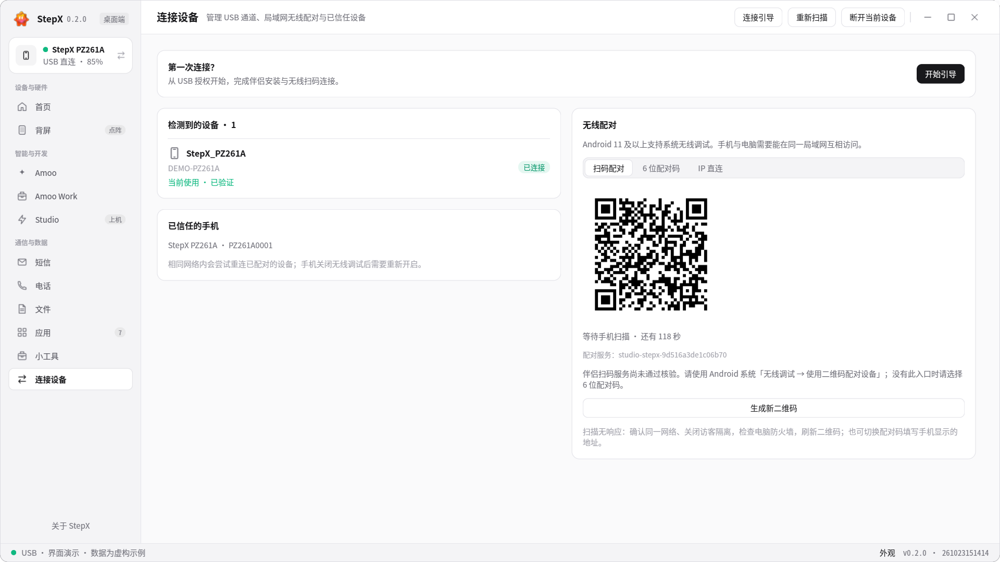
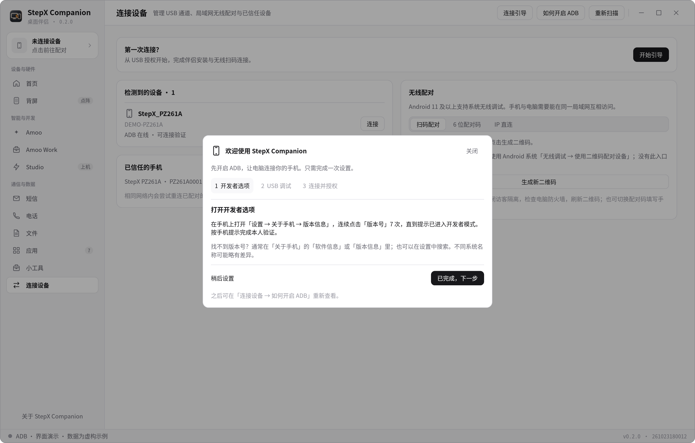

# 第一次连接

*截图为虚构演示状态。*

## 电脑端无需预装 ADB

0.2.1 完整发布包自带 ADB、scrcpy 和安装运行时。Windows 请先完整解压 ZIP，再启动 EXE；macOS 请保留整个 StepX Companion.app，拖入 Applications 后启动。不要只复制 EXE，也不要从压缩包中直接运行。客户端优先使用包内工具，不依赖 Android Studio 或终端 PATH。

## 首次启动：开启 ADB

新用户首次启动会看到三步连接弹窗。可点「稍后设置」关闭，之后从「连接设备 → 如何开启 ADB」重新打开；已连接过或已跳过的用户不会重复收到弹窗。

1. **开发者选项**：在手机「设置 → 关于手机 → 版本信息」中，连续点击「版本号」7 次，按手机提示完成本人验证。部分系统将它放在「软件信息」下。
2. **USB 调试**：回到设置搜索「开发者选项」，打开其中的「USB 调试」，确认系统提示。
3. **连接并授权**：用支持数据传输的 USB 线连接电脑，保持手机解锁，在「允许 USB 调试」弹窗中核对并允许这台电脑。只有自己的可信电脑才勾选「一律允许」。

点击「已允许，重新检测」后，弹窗根据真实连接状态显示结果。待授权时在手机确认；离线时解锁并重插数据线；未检测到时更换线材或 USB 接口。验证连接成功后，可进入桌面或继续安装 StepX伴侣。

参考 [Android 官方连接说明](https://developer.android.com/codelabs/basic-android-kotlin-compose-connect-device)。菜单名称可能因系统版本不同而变化。

## USB 驱动与诊断

Windows 若无法识别手机，请使用手机厂商提供的 USB 驱动。Linux 可能需要发行版的 Android udev 规则并重新连接设备。可运行 `stepx-companion --doctor` 检查 ADB；诊断输出含设备信息，分享前请脱敏。

## 安装 StepX伴侣

进入「小工具 → StepX伴侣/系统服务」或连接向导，选择安装。手机可能要求确认 USB 安装、通知、摄像头（扫码）与相关服务权限。按界面说明授予当前功能需要的权限。系统权限或 root 相关能力仅在已支持的设备环境可用；安装普通 APK 不会自动取得 root。

## 无线扫码与文件互传

先完成 USB 授权，手机与电脑连接同一可信网络。打开桌面连接页和手机伴侣扫码页，按提示扫描二维码并确认配对。不要公开二维码或配对码。配对完成后可测试文件互传，再拔掉数据线。公共网络隔离或防火墙可能阻止发现与连接。

## Amoo 与 Work

手机先登录 Amoo，再在桌面同步会话。账号与 token 用量可从「首页」右上角「账号与用量」查看。Work 可选择手机处理、桌面协作或图片创作。桌面协作应选择专用工作文件夹，添加资料后描述任务，在成果栏查看输出。若模型或权限不可用，按返回状态处理，不要反复提交相同任务。

## 附件与缓存

成功下载的附件可在本地缓存中再次预览。已经过期且从未缓存的链接无法凭空恢复；可在手机重新获取原文件后导入。图片分析依赖当前模型支持图片输入。

## 更新和清理

工具箱中的更新检查面向手机 OTA。清理、卸载及系统修改前核对对象和备份；不要将其他机型固件安装到当前设备。Google 兼容性工具不提供设备认证保证。
