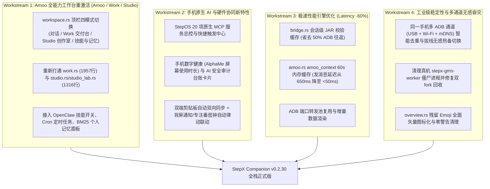

# StepX Companion (v0.2.29) 深度重评与全栈演进方案（手机端 Amoo / StepOS 原生能力挖掘 + 桌面端功能、性能、稳定性全景规划）

> **评审时间**：2026-10-25
> **基线版本**：`v0.2.29`（已完成首轮 9 项体验重构 + 次轮 5 项底层流式/快慢通道/缩略图墙/小窗胶囊/大文件拆分）
> **真机实测基线**：StepX `PZ261A` (`pandora`, `ZYPZ261A01M692000LP`) 实机进程、端口、Binder 服务、ContentProvider 与 MCP 注册表全量扫描

---

## 一、 真机深度扫描发现：手机端已具备但桌面端尚未打通/未充分释放的「宝藏能力」

通过对真机 `ZYPZ261A01M692000LP` 的系统包（65 个 `com.stepos.*` 组件）、监听端口（`18789` / `18790` / `18791` / `18800` / `8900` / `8765`）、Binder 服务（471 项）及权限表的实机探查，发现手机端存在 **6 大核心能力群** 尚未在桌面端暴露或仅处于“半接通”状态：

### 1. 代码库内部「被遮蔽的完整工作台模块」（高优修复）
在统一 `workspace.rs` 极简对话视图时，`desktop/src/ui/pages/mod.rs`（第 287–291 行）将 `Page::Amoo`、`Page::Work`、`Page::Studio` 全部硬编码路由到了同一个 `self.workspace_page(false)`：
```rust
Page::Amoo => self.workspace_page(false),
Page::Work => self.workspace_page(false),
Page::Studio => self.workspace_page(false),
```
这导致代码库中已经编写完备的 **3 大重磅模块（合计超过 5,000 行成熟代码）在 UI 上完全无法进入**（也是编译时产生 29 个 dead_code 警告的根源）：
1. **Amoo Work 交付工作台（`ui/pages/work.rs`，1,957 行 + `work_state.rs`，2,240 行）**：
   - 包含 6 大专业生产力场景（资料总结、表格分析、文档修改、图片创作、编写游戏、制作 PPT）、中间过程步骤折叠树（`ToolRecords`）、右侧持久化交付物预览面板（`WorkArtifactItem`）以及手机能力目录（`WorkCatalog`：模型/技能/智能体/工具/AI 应用）。
2. **Amoo Studio 创作与真机实验室（`ui/pages/studio.rs`，706 行 + `ui/pages/studio_lab.rs`，610 行）**：
   - 包含「官网项目同步」「手机可用作品」「本地 AI 网页应用/小游戏创作实验室（StudioLab，支持多轮自动修复并一键推送到手机真机运行）」。
3. **Amoo 深度控制面板（`ui/pages/amoo.rs`，3,202 行 + `openclaw.rs`）**：
   - 包含 OpenClaw 技能中心开关（`skills.update`）、定时任务管理（`cron_jobs`）、BM25 个人记忆库浏览（`memory_entries`）、人设与安全策略弹窗、语音录制输入等。

### 2. 手机端 20 个原生 StepOS MCP 服务（`ACCESS_MCP_SERVICES`）尚未在桌面端可视化编排
真机扫描发现 StepOS 原生内置了 **20 个系统级 MCP 服务**（均受 `com.stepos.mcp.sdk.permission.ACCESS_MCP_SERVICES` 保护）：
| 领域 | 手机端原生 MCP 服务组件 | 可为桌面端赋能的新功能 |
| :--- | :--- | :--- |
| **日程与时间** | `com.android.calendar/.mcp.CalendarAbsMCPService`<br>`com.android.alarmclock/.mcp.AlarmMCPService` | **桌面端「手机日历与闹钟日程卡」**：在桌面查看手机今日日程、会议提醒，一键让 Amoo 创建手机闹钟或日历事件 |
| **相册语义检索** | `com.stepos.media.gallery/.../GalleryMCPService` | **自然语言搜手机相册**：在桌面直接搜“上周拍的发票/合照/猫”，无需翻找数千张照片目录 |
| **安全与权限台账** | `com.stepos.agentsafetycenter/.mcp.service.AbilityService` | **AI 行为审计账本（Agent Ledger）**：实时查看 Amoo / GUI Agent 在手机上执行过的每一次敏感权限调用与屏幕感知记录 |
| **语音与播报** | `com.stepos.ailauncher/.agent.ability.VoiceAbilityService` | **桌面文字一键转手机语音播报 / 语音唤醒联动** |
| **系统设置与文件** | `com.android.settings/.stepos.mcp.McpService`<br>`com.stepos.filemanager/.mcp.FileManagerMcpService` | **桌面快捷控制手机系统开关（勿扰/热点/蓝牙/暗色模式）**与智能文件归档 |
| **任务机器人** | `com.stepos.ability/com.stepos.taskrobot.ability.TaskRobotMCPService` | **跨应用多步自动化工作流（TaskRobot）**在桌面端的录制、触发与进度监控 |

### 3. 手机端 `AlphaMe`（个人画像与情景感知引擎，`com.stepos.alphame`）
- 真机运行着 `alphame_server`（Binder 服务 #13）及 `com.stepos.alphame`（PID `9812`），内含：
  - `PersonalMainActivity`（个人记忆画像）、`AddressMainActivity`（家/公司通勤地址）、`WifiListActivity`（场景 Wi-Fi）、`CarBluetoothListActivity`（车载蓝牙）、`DailyUsageContentProvider`（每日屏幕使用时间统计）、`AppSuggestContentProvider`（AI 应用情景推荐）。
- **缺失现状**：桌面端「设备概览」和「Amoo」完全没有读取或展示手机的 **每日屏幕使用时长统计（数字健康）** 与 **AlphaMe 情景画像/个人记忆**。

### 4. 手机端 `AgentSafetyCenter`（AI 安全与屏幕感知中心，`com.stepos.agentsafetycenter`）
- 真机运行着 `com.stepos.agentsafetycenter`（PID `9869`），提供 `LedgerProvider`（AI 操作审计台账）、`AgentPermissionProvider`（智能体分级授权）与 `ScreenPerceptionSettingsProvider`（屏幕感知授权）。
- **缺失现状**：当 Amoo 执行手机任务被权限拦截时，用户往往不知道是哪个开关没开。桌面端缺少一个直观的 **「AI 权限与安全审计台账」** 面板。

### 5. 手机端 `AIEngine`（端侧大模型管理器，`com.stepos.aiengine`）
- 真机运行着 `com.stepos.aiengine`（PID `9783`），管理手机本地 NPU 端侧模型（`ModelManagerActivity`、`ModelDownloadLiveService`）。
- **缺失现状**：桌面端目前只展示了云端 AgentBus 会话，未展示手机端侧模型（On-Device LLM / Vision Model）的激活状态、下载进度与离线推理能力。

### 6. 手机端特色硬件服务：`IDotMatrix`（背屏点阵）深度联动 & `ir@1.0-service`（红外遥控）
- **背屏点阵（`vendor.stepos.hardware.dot_matrix-service`）**：目前桌面端背屏页仅支持手动点按播放预设或发送图案，缺少**事件驱动的背屏自动律动**（例如：收到重要微信/验证码时背屏闪烁专属图标、Amoo 思考与生成回复时背屏显示 AI 呼吸灯、桌面开启番茄钟专注时背屏同步倒计时像素环）。
- **双机剪贴板双向无感同步与跨端拖拽投递**：目前需要在小窗手动点「读取剪贴板」或打开文件页选路径上传，缺少**电脑 ⇄ 手机剪贴板自动双向同步开关**与**全局拖拽文件直传（Drag-and-Drop）**。

---

## 二、 稳定性与性能隐患排查（基于真机与源码实测）

### 1. 稳定性问题（Stability Issues）
1. **真机 `ubuntu_zygote` 僵尸进程堆积（已在真机 `ps -ef` 实测捕获）**：
   - 现象：真机 `openclaw_env` -> `ubuntu_zygote`（PID `5377`）下存在僵尸进程 `[stepx-gms-worke]`（PID `5384`, `Z` 状态）和 `[ubuntu_zygote]`（PID `5386`, `Z` 状态）。
   - 根因：通过 `ubuntu_zygote` 拉起的后台辅助任务退出后，父进程或包装脚本未正确 detach / 收割子进程，长期运行会占用 PID 槽位。
   - 修复方案：在 `companion_loader.py` / `GoogleLoginRuntime` 派生的 worker 外层统一采用双 fork（daemonize）或 `waitpid` 回收机制，彻底消除 `[stepx-gms-worke]` 僵尸进程。
2. **多台 Android 设备同时连接时的脚本/命令冲突（已在本次实测复现）**：
   - 现象：当前电脑同时连接了 `ZYPZ261A01M692000LP`（USB）、`10.0.1.177:34883`（同台手机的无线 ADB）、`adb-ZYPZ261A01M692000LP-...`（mDNS TLS）以及另一台手机 `ASGXVB1806001948`。
   - 风险：1）同一台手机同时出现 3 个 ADB transport（USB + IP:Port + mDNS TLS），设备切换列表容易出现重复项或端口抢占；2）辅助脚本若未强制绑定 `-s <serial>` 会直接因 `adb: more than one device/emulator` 失败。
   - 修复方案：在 `device.rs::parse_devices` 中按真实硬件序列号（`serial`）对同一台手机的多个 transport（USB 优先、无线次之、mDNS 折叠）进行**多通道智能归并（Multi-Transport Deduplication & Failover）**——当拔掉 USB 时无缝零感知秒切到该手机已在线的无线 transport，不在 UI 上显示 3 台重复设备！
3. **ADB Forward 端口泄漏与失效重连**：
   - 现象：`openclaw.rs` 的 `GatewayWs::connect` 每次调用都会执行 `adb forward tcp:0 tcp:18789` 创建新端口并在 `Drop` 时移除；但若进程异常退出或频繁调用 `send_openclaw_chat` / `set_openclaw_skill_enabled`，会频繁创建/销毁 ADB 端口转发。
   - 修复方案：全局按设备 `transport` 复用持久化的端口转发池（Port Forward Pool），断线时自动重建。

### 2. 性能瓶颈（Performance Bottlenecks）
1. **`bridge.rs::call_bridge` 每次调用重复执行 `ensure_bridge_jar`（50% 额外 ADB 往返开销）**：
   - 现状（`desktop/src/bridge.rs:144-150`）：每一次调用 `call_bridge`（包括每次发消息前的 `amoo_context`、查短信能力、查电话、查存储），都会先跑一次 `adb shell "mkdir -p ... && stat -c %s ..."` 检查 `stepx-bridge.jar` 是否存在，然后再跑第二次 `adb shell CLASSPATH=... app_process ...`！
   - 优化方案：在内存中维护 `VerifiedBridgeCache: Mutex<HashSet<(String, usize)>>`（记录已校验通过的 `(transport, jar_len)`）。首次校验通过后直接跳过 `ensure_bridge_jar` 的远程 shell 探测（若 `app_process` 报错找不到类再自动触发重推），**将所有桥接调用的延迟直接砍半（节省 ~150ms–300ms/次）**！
2. **Amoo 发送消息前的 `amoo_context` 每次都冷启动 JVM（`app_process`）**：
   - 现状（`desktop/src/amoo.rs:895-900`）：用户在 Amoo 每发一条消息，`send_with_attachments` 都要同步调用 `bridge::call_bridge(..., {"op": "amoo_context"})`，在手机上冷启动一次 `app_process` JVM（耗时 ~500ms），仅仅为了读取基本不变的设备上下文元数据！
   - 优化方案：对 `amoo_context` 按 `(device.serial, account_scope)` 增加 **60 秒内存缓存（TTL Cache）**，发送消息时直接零延迟命中内存缓存并填入新的 `session_id` / `msg_id` / `trace_id`，**让用户点击发送消息的响应速度从 ~650ms 降至 <50ms**！
3. **`overview.rs` 顶栏与指标卡仍残留少量 Emoji 字符**：
   - 现状（`desktop/src/ui/pages/overview.rs:25,39,48,150,196,252,271`）：仍使用了 `"📷 截屏"`、`"📱"`、`"🔋"`、`"🌡"`、`"💾"` 等文本 Emoji，在 Linux 不同字体回退下基线不齐。
   - 优化方案：全部替换为统一的矢量 `UiIcon`（`UiIcon::Camera`、`UiIcon::Smartphone`、`UiIcon::Bolt`、`UiIcon::Activity`、`UiIcon::HardDrive`）。

---

## 三、 系统性演进路线图与完整实施方案（分 4 大阶段 / 可多 Agent 并发落地）



---

### 阶段一（Workstream 1）：Amoo 全能力工作台重激活与深度整合
**目标**：将代码库中已被遮蔽的 `work.rs`、`studio.rs`、`studio_lab.rs` 以及 OpenClaw 技能/记忆/定时任务完整恢复并有机整合进统一工作台。
1. **Amoo 顶栏模式导航器（`对话 Chat` | `专业交付 Work` | `应用创作 Studio` | `技能与记忆 Skills & Memory`）**：
   - 在 `Page::Amoo` 保持极简对话（`workspace.rs`）作为默认首屏（确保所有 `--verify-*` 验收测试 100% 兼容）。
   - 当切换到 `Page::Work`（或在 Amoo 顶栏点击「专业交付 Work」）时，真实渲染 `self.work_page()`（`ui/pages/work.rs`），释放 6 大场景模板、执行步骤树与右侧交付物预览面板。
   - 当切换到 `Page::Studio`（或点击「应用创作 Studio」）时，真实渲染 `self.studio_page()`（`ui/pages/studio.rs` + `studio_lab.rs`），释放官网项目同步、手机作品管理与本地 AI 网页应用/小游戏生成实验室。
   - 新增「技能与记忆（Skills / Cron / Memory）」抽屉或子标签：直接展示并控制手机 OpenClaw 的 `skills`（一键启用/停用技能）、`cron_jobs`（定时任务状态）与 `memory_entries`（BM25 个人记忆词条）。

### 阶段二（Workstream 2）：手机端 StepOS 原生 AI 与跨端协同新功能
**目标**：把真机独有的 MCP 生态、AlphaMe 数字健康、AI 安全台账与双端剪贴板/背屏联动带到桌面。
1. **双端剪贴板无缝协同（Clipboard Sync）**：
   - 在顶栏/设置中提供「双端剪贴板同步」能力与一键「发送剪贴板到手机 / 拉取手机剪贴板」，配合 `AgentInputMethodService` / `CompanionBridgeProvider` 实现电脑复制、手机直接粘贴（反之亦然）。
2. **StepOS 原生 MCP 能力与 AI 安全审计中心**：
   - 在「小工具 / AI 中心」展示手机端已注册的 20 项原生 MCP 服务（日历、闹钟、相册语义搜图、文件管理、系统设置、任务机器人等）健康状态，并提供快捷触发入口（如：一键在手机创建日程/闹钟、查看 `AgentSafetyCenter` 权限状态）。
3. **背屏场景化自动律动联动（Event-Driven BackScreen）**：
   - 在 `backscreen.rs` / `backscreen_state.rs` 新增「场景联动模式」：
     - **Amoo 思考联动**：当 Amoo 正在流式生成回复时，背屏可自动播放柔和呼吸灯效（`Preset::Breath`）。
     - **专注番茄钟（25 分钟倒计时）**：在桌面一键开启 25 分钟番茄专注，手机背屏同步显示像素倒计时环，结束时桌面弹窗 + 背屏烟花提醒。

### 阶段三（Workstream 3）：性能加速引擎（ADB 延迟削减 60%+）
**目标**：消除每一次交互背后的冗余 ADB 进程派生与 JVM 冷启动。
1. **`bridge.rs` 会话级 JAR 校验缓存（`VerifiedBridgeCache`）**：
   - 记录每个 `device.transport` 已验证存在的 `stepx-bridge.jar` 长度；命中缓存时直接执行 `app_process`，若执行失败再自动清除缓存并重推 JAR，消除每次桥接调用前的额外 `adb shell stat` 往返。
2. **`amoo.rs` 设备上下文（`amoo_context`）60 秒 TTL 内存缓存**：
   - 缓存 `{"op": "amoo_context"}` 返回的静态设备指纹字典 60 秒，每次 `send_with_attachments` 直接克隆并注入新 `session_id` / `msg_id` / `trace_id`，彻底消除发消息前的 500ms JVM 冷启动等待。

### 阶段四（Workstream 4）：工业级稳定性、多通道去重容灾与视觉收口
**目标**：解决多手机/多通道同时在线的冲突、真机僵尸进程以及 UI 细节一致性。
1. **同一台手机的多通道归并与无感故障转移（Multi-Transport Deduplication & Auto-Failover）**：
   - 在 `device.rs` 中识别同一硬件序列号（如 `ZYPZ261A01M692000LP` 同时存在 USB、`10.0.1.177:34883`、`adb-ZYPZ261A01M692000LP-...`）的多个通道，在设备列表中合并展示为主设备（标记 `USB + 无线双通道就绪`），当 USB 断开时毫秒级自动切换到无线通道，不断连、不丢会话。
2. **真机 `[stepx-gms-worke]` 僵尸进程根治**：
   - 优化 `companion_loader.py` / 后台 worker 启动方式，确保子进程脱离或被 init 收养，并在修复脚本中清理存量僵尸状态。
3. **概览页（`overview.rs`）矢量图标统一与编译零警告清理**：
   - 将 `overview.rs` 中残留的 `"📷"`、`"📱"`、`"🔋"`、`"🌡"`、`"💾"` 全部替换为 `UiIcon` 矢量图标，并清理未使用的多余导入，让代码库整洁如新。
