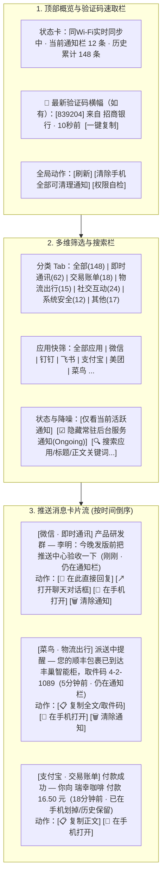
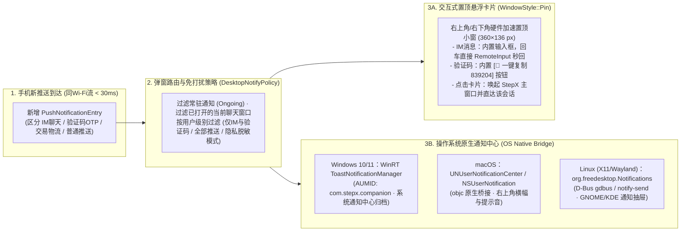

# StepX 主流聊天软件对话框直接回复与手机全量推送查看中心集成方案（2026-10-23）

## 1. 背景与核心目标

在真实使用场景中，**绝大多数用户不会一直插着 USB 数据线，而是让手机与电脑处于同一个 Wi-Fi 局域网下（手机常处于锁屏/熄屏放置在桌面或口袋中）**。

基于对 `JiayuStudio/stepx-neo-lab`（`guides/neo-agent-touch` `v0.1.16-beta.1`）的深度拆解，以及我们现有的 [StepX伴侣 (`com.stepx.companion.app`)](file:///home/zhengfa/work/stepx/desktop/companion-app/AndroidManifest.xml) 与 [StepX 桌面端 (`desktop/src/`)](file:///home/zhengfa/work/stepx/desktop/src/main.rs) 架构底座，本方案旨在实现四大核心能力，并针对 **同 Wi-Fi 无线使用场景** 进行专项架构设计与评估：

1. **主流聊天软件在 StepX 内显示原生对话框并直接回复（IM Chat Hub）**
   - 像现有的短信页面（[`desktop/src/ui/pages/sms.rs`](file:///home/zhengfa/work/stepx/desktop/src/ui/pages/sms.rs)）一样，**直接在 StepX 客户端内展示微信、企业微信、钉钉、飞书、QQ、Telegram、WhatsApp、Slack 等主流聊天软件的会话列表与聊天气泡对话框**。
   - 用户（或 AI 助手）直接在 StepX 对话框底部输入框打字并点击发送，即可将消息直接回复至对应聊天软件。
2. **显示来自手机全部推送的消息查看中心（Phone Push Notification Center）**
   - 在 StepX 客户端新增独立的 **「手机推送」** 页面，实时捕获并展示来自手机上**全部应用**的推送通知（涵盖即时通讯、社交互动、交易账单、物流出行、系统安全、资讯等）。
   - 支持按应用/分类/状态筛选、全文搜索、验证码（OTP）智能提取与一键复制、带回复句柄的通知直接内联回复、单条/批量同步清除手机通知栏消息，以及一键在手机/投屏中打开对应通知。
3. **跨平台桌面弹窗推送提醒（Windows / macOS / Linux）**
   - 支持双层桌面提醒机制：既能弹出带内联回复输入框与验证码复制按钮的 StepX 置顶悬浮卡片（`WindowStyle::Pin`），也能同步投递至 Windows WinRT Toast、macOS Notification Center、Linux D-Bus 原生系统通知中心。
4. **两大高频轻量简洁模式（AI 简洁模式 & 通知小窗模式）**
   - **简洁模式一：AI 简洁模式（AI Mini Chat）**：剥离复杂的多栏工作台与设备调试面板，提供纯粹、轻量的简单对话窗口，随时向 AI 提问、总结手机未读消息或下达一句话手机操控指令。
   - **简洁模式二：通知小窗模式（Notification Mini Window）**：常驻或挂靠在桌面边缘的精简通知/聊天小窗，实时滚动展示手机新消息与推送，并支持**直接在小窗内展开上下文、打字回车秒回微信/钉钉/飞书/短信或一键复制验证码**，无需切回主窗口。

---

## 2. 同 Wi-Fi 局域网场景专项评估（核心工程约束与架构决策）

当用户在 **同一个 Wi-Fi**（拔掉 USB 线、手机大概率处于熄屏锁屏状态）下使用本功能时，会面临与有线 USB 截然不同的 4 个核心技术问题。以下为逐项评估与架构对策：

### 2.1 痛点评估：为什么同 Wi-Fi 下不能只靠轮询 `adb shell content call`？

| 评估维度 | 传统方案：每 2~3 秒执行 `adb shell content call` | 优化方案：**同 Wi-Fi 持久流隧道（LocalSocket + LAN Direct 双栈）** |
| :--- | :--- | :--- |
| **实时性与延迟** | 每次调用需在手机端 fork `sh` + `app_process`（耗时 **400~900ms**），无法做到微信来消息瞬间电脑弹窗 | 手机 `NotificationListenerService` 监听长连接流，消息到达后 **< 30ms 主动推送（Server-Pushed）** 到电脑，回复耗时 **< 100ms** |
| **手机发热与功耗** | 高频 fork JVM 进程导致手机在 Wi-Fi 待机下 CPU 无法休眠，显著掉电 | 零进程 fork 开销，闲时零流量，仅在通知到达或用户发送回复时传输数 KB JSON |
| **手机熄屏 Doze 休眠** | 拔掉 USB 后手机进入 Doze，Wi-Fi 省电休眠导致外部轮询频繁超时 | 借力 Android 系统机制：微信/钉钉来通知时，`system_server` 自动唤醒 `NotificationListenerService`，伴侣顺势持 3 秒短期 `WifiLock` 将消息主動推给电脑 |
| **手机重启/无线调试断开** | 手机重启后 Android 自动关闭无线 ADB，用户必须重新插线或重新配对才能看消息 | `NotificationListenerService` 由系统开机自启；配合同 Wi-Fi 局域网加密通道（基于已配对 Token），**即使无线 ADB 未开也能在同 Wi-Fi 下收看推送与秒回消息** |

### 2.2 同 Wi-Fi 下的双栈通信架构（Dual-Stack Transport over Wi-Fi）

为保证同 Wi-Fi 下 **“最快速度 + 最高可靠度 + 零配置”**，设计双栈传输通道（桌面端自动择优）：

1. **首选栈 A：Wireless ADB `forward` 本地流套接字（零防火墙阻碍）**
   - 当同 Wi-Fi 下的无线调试已连接（由 [`discovery.rs`](file:///home/zhengfa/work/stepx/desktop/src/discovery.rs) mDNS `_adb-tls-connect._tcp` 自动发现连接）时：
   - 手机端 `PushNotificationService` 创建 `LocalServerSocket("stepx_push_v1")`（校验 `PeerCredentials.uid == 2000 || myUid()`）；
   - 桌面端执行一次 `adb -s <wifi_serial> forward tcp:0 localabstract:stepx_push_v1`，直接通过本地 TCP 长连接收发双向 JSON Lines 事件流。
   - **效果**：复用 ADB TLS 加密，绕过路由器端口限制，彻底消灭 `adb shell` 进程启动开销，实测往返延迟 **5~15ms**。

2. **并列栈 B：同 Wi-Fi 局域网直连（LAN TLS/HMAC Socket + mDNS 广播）**
   - 在首次配对（USB 或扫码配对 [`pairing.rs`](file:///home/zhengfa/work/stepx/desktop/src/pairing.rs)）时，桌面端与手机端通过 [`companion_link.rs`](file:///home/zhengfa/work/stepx/desktop/src/companion_link.rs) 协商并持久化 256-bit 共享密钥 `lan_push_secret`（保存在手机 `Vault` Keystore 与电脑 `~/.config/stepx-companion/`）。
   - 手机端 `PushNotificationService` 在检测到 Wi-Fi 连接时，在局域网端口（并通过 Android `NsdManager` 注册 `_stepx-push._tcp.`）提供带 HMAC-SHA256 双向认证与 AES-GCM 加密的推送流接口。
   - **效果**：即使手机重启导致无线 ADB 失效，只要手机和电脑连在同一个 Wi-Fi 下，桌面端通过 [`discovery.rs`](file:///home/zhengfa/work/stepx/desktop/src/discovery.rs) 发现 `_stepx-push._tcp.` 即可立即恢复全部推送查看与聊天直接回复！

3. **兼容栈 C：`PushControlProvider`（`content://com.stepx.companion.app.push`）**
   - 作为标准 ContentProvider 兜底，供一次性查询、脚本诊断与测试调用。

---

### 2.3 同 Wi-Fi 下手机不同状态的「直接回复」可行性矩阵

用户在同 Wi-Fi 下使用手机时，手机最常见的状态是 **“熄屏锁屏放在桌上”**。两种回复通道在不同手机状态下的表现如下：

| 手机当前状态 | 通道一：`RemoteInput` 原厂通知快捷回复（占日常回复 **95%**） | 通道二：`neo-agent-touch` 无障碍看屏自动投递（占主动新建会话 **5%**） | StepX 客户端交互策略 |
| :--- | :--- | :--- | :--- |
| **状态 1：手机熄屏 + 已锁屏（同 Wi-Fi 最常见场景）** | ✅ **100% 可直接回复（< 150ms）**<br/>无需亮屏、无需解锁、无需打开微信/钉钉界面，系统后台直接触发原厂 `PendingIntent` 发出 | ❌ 锁屏下无障碍服务无法操作锁屏后的微信界面 | 只要该会话收到过消息（持有 `RemoteInput` 句柄），在熄屏锁屏下可**无限次直接秒回**；若无句柄，UI 提示“请解锁手机屏幕或等对方发来消息后直接秒回” |
| **状态 2：手机亮屏，正在逛其他 App（如刷视频/看网页）** | ✅ **100% 无感后台秒回**<br/>不会打断手机当前正在看的视频或页面 | ⚡ 可自动切换前台打开微信/钉钉发送（会短暂切走当前画面 2~3 秒） | 有句柄时强制优先走 `RemoteInput` 无感秒回；无句柄时弹窗确认是否允许临时切屏发送 |
| **状态 3：手机亮屏，正好停留在当前聊天窗口** | ✅ 可用（若通知栏未清除） | ✅ **毫秒级直接填入当前输入框并点发送**<br/>还能实时抓取屏幕上的历史气泡同步到 StepX | 优先检查 `RemoteInput`，若手机正好在该聊天页因此系统未发通知，则无缝无缝切换无障碍直接写入当前输入框并点发送 |

> [!IMPORTANT]
> **`RemoteInput` 句柄保活关键技巧（支持连续追发多条消息）**：
> 在微信、钉钉、飞书、Telegram、QQ 中，通知栏携带的 `RemoteInput` `PendingIntent` 在发送完第一条回复后**并不会立即失效**——只要我们的 `PushNotificationService` **不主动调用 `cancelNotification()` 销毁该通知**，同一个 `RemoteReplyHandle` 可以在内存中保留，支持用户在 StepX 对话框里**连续发送第 2 条、第 3 条补充回复**，且全程无需点亮手机屏幕！

---

### 2.4 同 Wi-Fi 长期运行（7×24 小时/跨天跨周）的 8 大稳定性隐患与自愈优化方案

从长期高频使用场景来看，用户每天带着手机进出办公室/家里、手机重启、路由器重分配 IP、笔记本合盖休眠、手机长时间熄屏进入深睡（Deep Doze），都会考验同 Wi-Fi 连接的稳定性。针对这 **8 类真实长期隐患**，设计如下闭环自愈机制：

| 序号 | 长期同 Wi-Fi 稳定性隐患 | 根因分析 | StepX 工程自愈与优化方案 |
| :--- | :--- | :--- | :--- |
| **1** | **无线调试被系统自动关闭或端口随机漂移** | 手机重启、走出工位断开 Wi-Fi、或闲置超时后，Android 会自动把 `adb_wifi_enabled` 置 `0`，或重连时分配全新随机端口（如 `38129 -> 44910`） | **① 权限自愈重开**：复用伴侣已持有的 `WRITE_SECURE_SETTINGS` 权限（见 [`AndroidManifest.xml`](file:///home/zhengfa/work/stepx/desktop/companion-app/AndroidManifest.xml#L14-L15)），当 `ConnectivityManager.NetworkCallback` 监听到手机连回已信任 Wi-Fi 时，自动检测并恢复 `Settings.Global("adb_wifi_enabled") = 1`；<br/>**② 端口实时跟随**：伴侣原生 LAN 通道与 [`discovery.rs`](file:///home/zhengfa/work/stepx/desktop/src/discovery.rs) mDNS 实时通告新端口，桌面端秒级自动切换重连。 |
| **2** | **办公网屏蔽 mDNS 组播 & 跨天 DHCP IP 变化** | 企业路由器常过滤 UDP `5353` 组播包导致 mDNS 失效；次日上班手机 DHCP IP 发生变更 | **① 手机反向单播信标（Reverse Unicast Beacon）**：手机持久化记住上次配对电脑的局域网 IP，连上 Wi-Fi 或收到新微信时主动向电脑发送加密单播包，无视路由器组播屏蔽；<br/>**② 桌面端 `/24` 子网并发快扫兜底**：当缓存 IP 失联且 mDNS 无响应时，1.5 秒非阻塞并发探测同网段找回手机新 IP。 |
| **3** | **手机长时间熄屏进入 Deep Doze 导致电脑发消息超时** | 熄屏 30 分钟后手机进入深度休眠，Wi-Fi 处于 PS-Poll 省电态，电脑主动请求延迟高达数秒甚至半开死连接 | **① 手机事件驱动上推 + 60 秒热态窗口**：微信来通知由系统内核唤醒手机，`PushNotificationService` 顺势持 3 秒 `WakeLock` 上推电脑，并在随后 **60 秒（高概率回复期）** 保持 `WIFI_MODE_FULL_LOW_LATENCY`，确保用户看到弹窗立即打字秒回 0 延迟；<br/>**② 原生 `CloudWake` 协同唤醒**：电脑主动发任务时联动 [`AmooConnectionService.java`](file:///home/zhengfa/work/stepx/desktop/companion-app/src/com/stepx/companion/app/AmooConnectionService.java) 唤醒手机。 |
| **4** | **`NotificationListenerService` 长期运行假死断连** | Android 系统级偶发通病：运行数天或伴侣热更新后，通知监听开关虽开着但 Binder 断连不再回调 | **看门狗自愈重绑 (`requestRebind`)**：伴侣每次心跳自检 `isConnected` 标志，若未连接但 `enabled_notification_listeners` 已授权，立即自动调用 `NotificationListenerService.requestRebind()`，必要时通过 `WRITE_SECURE_SETTINGS` 自动刷新重绑，无需用户干预。 |
| **5** | **Wi-Fi 漫游/闪断瞬间的消息漏收与回复丢失** | 用户走进会议室切换 AP 或网络抖动的 2 秒内，新推送漏掉或小窗点“发送”失败 | **① 单调 `seq_id` 差量追平**：每条通知带自增 `seq_id`，重连后桌面端发送 `sync_since(last_seq)` 毫秒级补齐断网期间漏收的消息；<br/>**② 发送队列幂等重传（Outbox + `client_msg_id`）**：小窗/对话框回复先入本地发送队列（显示 `⏳发送中`），2 秒未收到手机 ACK 自动重传，手机端按 `client_msg_id` 幂等去重，绝不漏发或重发两遍。 |
| **6** | **用户在手机上点开过微信导致 `RemoteInput` 句柄状态不一致** | 用户在手机上点开微信后通知栏消失，或旧 `PendingIntent` 被系统回收抛出 `CanceledException` | **① 句柄缓存池软保留**：即使通知栏因用户在手机查看而被移除（`REASON_APP_CANCEL`），内存仍保留该会话最近有效的 `RemoteReplyHandle`（实测多数 IM 仍可继续静默回复）；<br/>**② 异常捕获无缝降级**：一旦 `PendingIntent.send()` 抛出 `CanceledException`，立即将该会话标记为需更新，并在手机解锁态自动降级至 `ChatUiBridge` 看屏发送。 |
| **7** | **电脑合盖休眠唤醒（Sleep/Resume）产生僵尸连接** | 笔记本合盖休眠再打开后，旧 `adb forward` 端口或 TCP 连接变成半开死连接（卡死 30 秒才报错） | **休眠时钟跳变检测 + 快速心跳剥离**：桌面端后台循环检测系统时钟跳变（相邻 tick `> 10s`）及 15 秒级双向 Ping/Pong，一旦发现休眠唤醒或心跳超时，500ms 内主动重建 `adb forward` 与 Socket 隧道并执行差量同步。 |
| **8** | **连续运行数周的内存、磁盘与高频通知风暴** | 群聊刷屏、下载进度条/音乐播放器每秒触发几十次 `onNotificationPosted` 导致卡顿与存储膨胀 | **① 进度/常驻通知节流合并**：对同 `key` 的进度条/媒体通知按 `2 秒` 窗口去重节流；<br/>**② 固定容量 RingBuffer + 原子落盘**：内存与磁盘严格限制上限（最近 500 条推送、每会话 100 条气泡、LRU 80 个回复句柄），采用 `1.5s 防抖 + .tmp + ATOMIC_MOVE` 防止文件损坏。 |

---

### 2.5 深度架构与体验进阶优化评估（并发隔离、富媒体、多端同步与智能托管）

除了网络连接与后台保活外，针对代码架构、聊天信息还原度、人机防冲突及日常高频效率，进一步评估出 **9 项高价值深度优化**：

| 领域 | 优化项 | 现有痛点 / 潜在短板 | 深度优化方案 |
| :--- | :--- | :--- | :--- |
| **架构并发** | **1. 快慢通道彻底隔离（独立 `push_worker`）** | 现有 [`actions.rs`](file:///home/zhengfa/work/stepx/desktop/src/ui/actions.rs#L1-L2) 中所有设备操作共用单线程 `adb_tx` 并受全局 `self.busy` 互斥锁限制；若后台正在传大文件、扫描应用或跑 Amoo 任务，收发消息会被阻塞数秒甚至报“设备忙” | 为「手机推送流 & 聊天秒回」建立**独立于 `adb_tx` 和 `self.busy` 的高优实时通道 (`push_tx`)**，即使主窗口正在传几个 GB 的文件，通知小窗依然 0 阻塞秒收秒回微信。 |
| **带宽与性能** | **2. 图标/头像磁盘缓存 + 增量帧传输** | 每次同步若重复传输应用图标与联系人头像 Base64，会导致 JSON 暴涨至数百 KB，加剧 Wi-Fi 功耗与反序列化延迟 | 桌面端建立 `IconDiskCache`（按 `<pkg, versionCode>` 与 `<avatar_sha1>` 落盘缓存），网络流平时仅传 `< 500B` 的纯文本 `PushDelta` 增量帧。 |
| **聊天还原度** | **3. 通知富媒体提取（图片缩略图 + 真实头像）** | 仅提取 `EXTRA_TEXT` 会导致对方发截图/照片时只显示冷冰冰的 `[图片]`，用户仍需掏手机查看 | 解析通知 `EXTRA_PICTURE`（大图预览）、`MessagingStyle` 消息图片 URI 及 `SenderPerson` 头像，压缩为 `< 30KB` WebP 随流同步，**在对话框和小窗内直接显示真实头像与聊天图片缩略图**。 |
| **多端一致性** | **4. 手机端已读自动消红点 & 消息撤回识别** | 用户拿起手机看完了微信，手机通知栏已消，但电脑小窗和弹窗还挂着未读红点；或者对方撤回了消息但电脑未更新 | 监听 `onNotificationRemoved(REASON_CLICK / REASON_APP_CANCEL)`，手机端阅读后**电脑实时自动清零对应未读数并收起悬浮弹窗**；识别 `“xxx”撤回了一条消息` 自动在气泡流打上撤回标记。 |
| **群聊完整性** | **5. 连续刷屏多条消息完整聚合** | 群聊 1 秒内连发 5 条消息时，仅读单行 `EXTRA_TEXT` 会丢失前 4 条 | 完整解析 `Notification.EXTRA_MESSAGES`（`MessagingStyle` 历史数组）与 `EXTRA_TEXT_LINES`（`InboxStyle`），按 `(sender, timestamp, text)` 指纹去重追加，群聊连发不漏句。 |
| **人机防冲突** | **6. 手机握持使用时的「智能避让 (Human-in-Use Guard)」** | 当无 `RemoteInput` 句柄需走无障碍切屏发消息时，若用户此刻正好拿着手机在刷视频或打字，直接切屏会打断用户操作 | `GuiAccessibilityService` 记录最近一次用户手指触屏时间 `lastTouchMs`：有 `RemoteInput` 句柄时 100% 后台无感发出；无句柄且检测到 **10 秒内用户正在触屏操作手机**时，先在桌面端提示确认，绝不强抢手机屏幕。 |
| **跨端效率** | **7. 验证码自动进剪贴板 & 通知链接电脑直开** | 收到验证码还要手动点复制；飞书/微信收到腾讯会议或 PR 链接还要在手机打开再转发到电脑 | **① 验证码自动复制（可选开关）**：收到高置信度验证码时自动写入电脑剪贴板（弹出提醒 `已自动复制 839201，直接 Ctrl+V`）；<br/>**② 链接提取**：自动识别通知正文中的 `https://` URL，在小窗提供 `[🌐 电脑浏览器打开]` 按钮。 |
| **极简小窗体验** | **8. 纯键盘极速工作流 & 贴边半透明停靠** | 频繁用鼠标点选会话和按钮打断写代码手感；小窗一直高亮显示遮挡视线 | 支持 `↑/↓` 切换会话 → 直接打字 → `Enter` 发送 → `Alt+D` 清除 → `Esc` 收起；支持**鼠标移开时小窗自动降低不透明度（半透明挂靠）**，鼠标移入或新消息到达时恢复高亮。 |
| **AI 赋能** | **9. AI 简洁模式「专注托管（防打扰秘书）」** | 开会或深度写代码时群消息狂弹太吵，全关掉又怕漏掉老板或家人急事 | 开启「🎯 AI 专注托管」后，普通群聊与营销推送静默归档不弹窗；**仅当识别到 `@我`、星标联系人/领导私信、或含“紧急/故障/验证码”时才弹窗**，结束后一键由 AI 汇总期间所有群聊要点。 |

---

## 3. 主流聊天软件全量集成矩阵（Mainstream IM Catalog）

系统在手机端通过 `ImAppCatalog` 内置以下主流聊天与私信软件的精确适配规则，并同时支持 **通用动态识别（Auto-Detection）**：

### 3.1 内置主流聊天软件清单与适配特性

| 类别 | 软件名称 | Android 包名 (`packageName`) | 通知 `RemoteInput` 静默直回 | 无障碍页面气泡读取 & 自动发送兜底 | 界面控件与风控适配要点 |
| :--- | :--- | :--- | :--- | :--- | :--- |
| **国内办公/社交核心** | **微信 (WeChat)** | `com.tencent.mm` | ✅ 原生支持（需开启微信“通知显示消息详情”） | ✅ 支持会话搜索、输入框写入与发送按钮点击 | 输入文字后右下角由“+”变为“发送” `Button`；点击必须经过 `TouchPointPicker` 随机像素微偏移，避免固定坐标风控 |
| **国内办公/社交核心** | **企业微信 (WeCom)** | `com.tencent.wework` | ✅ 原生支持 | ✅ 支持单聊/外部群/内部群搜索与发送 | 顶部标题含 `@企业名` 后缀时按前缀归一化匹配会话名 |
| **国内办公/社交核心** | **钉钉 (DingTalk)** | `com.alibaba.android.rimet` | ✅ 原生支持 | ✅ 原生节点树清晰，`EditText` 写入与右侧发送按钮稳定 | 支持识别 `@我`、群聊与单聊，自动剥离计数前缀 |
| **国内办公/社交核心** | **飞书 (Feishu / Lark)** | `com.ss.android.lark`<br/>`com.larksuite.suite` | ✅ 原生支持（支持普通消息与话题回复） | ✅ 支持输入框 `ACTION_SET_TEXT` 与 `InputConnection` | 复杂富文本卡片提取文本摘要，并在右上角提供“在投屏中查看原卡片” |
| **国内社交** | **QQ / TIM** | `com.tencent.mobileqq`<br/>`com.tencent.tim` | ✅ 原生支持（含 `MessagingStyle` 多条聚合） | ✅ 支持搜索框定位好友/群聊并发送 | 通知常采用 `MessagingStyle` 携带多条未读群消息，按时间戳逐条展开入库 |
| **国际主流通讯** | **Telegram / TG X / Nekogram** | `org.telegram.messenger`<br/>`org.telegram.messenger.web`<br/>`org.thunderdog.challegram`<br/>`tw.nekomimi.nekogram` | ✅ 极佳（完整 `MessagingStyle` + `RemoteInput`） | ✅ 支持 | 原生支持后台 `RemoteInput` 连续多次回复且句柄长期有效 |
| **国际主流通讯** | **WhatsApp / Business** | `com.whatsapp`<br/>`com.whatsapp.w4b` | ✅ 极佳（完整 `MessagingStyle` + `RemoteInput`） | ✅ 支持 | 群组通知包含 `conversationTitle` 与发送者分离字段 |
| **国际办公/社区** | **Slack / Discord / Teams / Signal / Messenger** | `com.Slack`<br/>`com.discord`<br/>`com.microsoft.teams`<br/>`org.thoughtcrime.securesms`<br/>`com.facebook.orca` | ✅ 原生支持 | ✅ 支持 | 按频道（Channel）/ 私信（DM）自动聚合为独立会话 ID |
| **社媒与电商私信** | **小红书 / 抖音 / 闲鱼 / 淘宝旺旺 / 京东 / 拼多多** | `com.xingin.xhs`<br/>`com.ss.android.ugc.aweme`<br/>`com.taobao.idlefish`<br/>`com.taobao.taobao`<br/>`com.jingdong.app.mall`<br/>`com.xunmeng.pinduoduo` | ⚡ 部分版本支持通知栏快捷回复 | ✅ 支持触发通知 `contentIntent` 直达私信页后由无障碍写入并发送 | 当无 `RemoteInput` 时，优先执行通知自带 `contentIntent` 直接跳进该买家/博主聊天窗口，再由无障碍填入文字并点发送 |
| **系统通信** | **系统短信 (SMS/MMS)** | Telephony Provider + `com.google.android.apps.messaging` | ✅ 走现有 [`sms.rs`](file:///home/zhengfa/work/stepx/desktop/src/sms.rs) 原生收发通道 | ✅ 原生 API 直接发送 | 与 IM 会话列表无缝并列或按渠道筛选 |

### 3.2 动态通用识别机制（未列举聊天软件自动兼容）
除上述固定包名列表外，`PushNotificationService` 对任意第三方应用通知执行以下判定，满足任一条件即自动提升为 **「可对话/可回复消息」**：
1. 通知 `extras` 含有 `Notification.EXTRA_MESSAGES`（即采用标准 `Notification.MessagingStyle`）；
2. 通知 `category` 为 `Notification.CATEGORY_MESSAGE`；
3. 通知 `actions` 数组中包含至少一个带有 `RemoteInput`（`action.getRemoteInputs() != null && action.getRemoteInputs().length > 0`）的快捷回复动作。

---

## 4. 聊天对话框与直接回复核心机制设计

### 4.1 会话归一化与消息去重规则（Thread Normalization）

每条来自聊天软件的通知或无障碍抓取记录，在手机端统一归一化为会话键 `threadId`：
$$\text{threadId} = \text{packageName} + \text{"::"} + \text{normalizeTitle}(\text{conversationTitle})$$

1. **会话标题清洗 (`normalizeTitle`)**：
   - 优先读取 `extras.getCharSequence(Notification.EXTRA_CONVERSATION_TITLE)`，次选 `extras.getCharSequence(Notification.EXTRA_TITLE)`。
   - 自动剥离常见未读计数修饰：如微信 `"[3条] 张三: 你好"` 中的 `"[3条] "`、`"研发群 (5)"` 或 `"研发群(5条新消息)"` 中的尾部括号计数，确保同一联系人在不同未读数下始终归入同一个 `threadId` 对话框。
2. **群聊发送者与正文分离**：
   - 若通知包含 `Notification.EXTRA_MESSAGES`（`MessagingStyle`），直接遍历每条 `Message` 获取精确的 `sender`、`text` 和 `timestamp`。
   - 若为普通单文本通知（如微信 `"[4条] 产品群: 李四: 方案发我一下"`），剥离 `"[4条] "` 后，识别出首段等于会话标题 `"产品群"`，再按下一个 `:` / `：` 切分出发送者 `"李四"` 与正文 `"方案发我一下"`。
3. **非聊天常驻通知过滤**：
   - 针对微信 `"微信正在后台运行"`、`"网页版/桌面版微信已登录"`、语音通话震动提示、文件下载进度条等，通过规则过滤，**不进入聊天会话列表**，仅展示在「手机推送」页面的系统/常驻分类下。

### 4.2 融合 `neo-agent-touch` 的无障碍聊天桥接（`ChatUiBridge`）

当用户在 StepX 中主动点击 **「同步当前屏上聊天记录」** 或在无 `RemoteInput` 句柄时使用 **「看屏通道发送」**，调用合入 [`GuiAccessibilityService`](file:///home/zhengfa/work/stepx/desktop/companion-app/src/com/stepx/companion/app/GuiAccessibilityService.java) 的 `ChatUiBridge`：

1. **解除 `neo-agent-touch` 原版对聊天发送的 3 处限制**：
   - **放行受控“发送”按钮**：原版 `ActionGuard.java` 拦截所有含 `"发送"` 的节点。新设计仅在 `ChatReplyContext` 激活且已校验屏幕顶部标题等于目标 `targetTitle` 时，允许点击 `"发送"` / `"Send"` 按钮。
   - **支持聊天输入框写入**：在 [`gui_accessibility.xml`](file:///home/zhengfa/work/stepx/desktop/companion-app/res/xml/gui_accessibility.xml) 开启 `flagInputMethodEditor|flagViewFocused`，支持通过 `ACTION_SET_TEXT` 或 Android 33+ `AccessibilityInputMethod.getCurrentInputConnection().commitText()` 向微信/钉钉/飞书底部输入框写入文字并读回校验。
   - **安全微偏移点击（`TouchPointPicker`）**：移植 `neo-agent-touch` 的 `TouchPointPicker.java`，在发送按钮可见边界内随机微偏移像素点击，避免每次点击固定中心点。
2. **屏上聊天气泡抓取（`captureActiveChatWindow`）**：
   - 当手机前台正打开微信/钉钉/飞书聊天页时，扫描可见文本节点：
     - 顶部栏（$y < 0.12 \times H$）：提取会话标题；
     - 消息区（$0.12 \times H \le y \le 0.85 \times H$）：按节点水平中心点判断归属（左半侧为对方收到消息，右半侧为我方发出消息），合并入对应 `threadId`。

---

## 5. 新增功能设计：来自手机全部推送的消息查看中心（Phone Push Notification Center）

在 StepX 客户端左侧导航栏新增 **「手机推送 (`Page::Notifications`)」** 独立页面，展示手机上**所有应用**发出的实时通知与历史推送流。

### 5.1 全量推送数据结构与智能解析（`PushNotificationEntry`）

每条手机推送在入库时经过 `PushClassifier` 处理，生成如下字段：

| 字段名 | 类型 | 说明 |
| :--- | :--- | :--- |
| `id` | `String` | 唯一事件 ID（`sbn.getKey() + ":" + sbn.getPostTime()`） |
| `key` | `String` | Android 系统 `StatusBarNotification.getKey()`，用于远端清除该通知 |
| `package_name` | `String` | 来源应用包名（如 `com.tencent.mm`、`com.eg.android.AlipayGphone`、`com. Cainiao.wireless`） |
| `app_name` | `String` | 手机本地 `PackageManager` 解析出的应用名称（如 `微信`、`支付宝`、`菜鸟`） |
| `category` | `String` | 6 大智能分类：<br/>- `im`：即时通讯（微信/企微/钉钉/飞书/QQ/TG/WhatsApp 等）<br/>- `social`：社交互动（小红书/抖音/微博/B站/知乎/GitHub 等）<br/>- `finance`：交易与账单（支付宝/微信支付/银行动账/信用卡/证券）<br/>- `delivery_travel`：物流与出行（顺丰/菜鸟/京东物流/美团/饿了么/滴滴/高德/12306/航旅纵横）<br/>- `system`：系统与安全（验证码/系统更新/权限/电量/安全中心）<br/>- `other`：资讯、工具与其他应用推送 |
| `title` | `String` | 推送标题（`EXTRA_TITLE` / `EXTRA_CONVERSATION_TITLE`） |
| `text` | `String` | 完整推送正文（优先取 `EXTRA_BIG_TEXT` 展开长文本，次选 `EXTRA_TEXT`） |
| `sub_text` | `String` | 副标题或摘要（`EXTRA_SUB_TEXT` / `EXTRA_SUMMARY_TEXT`） |
| `post_time_ms` | `i64` | 推送到达毫秒时间戳 |
| `removed_time_ms` | `Option<i64>` | 在手机通知栏被清除/划掉的时间戳（未清除则为 `None`） |
| `active` | `bool` | 当前是否仍在手机下拉通知栏中显示 |
| `ongoing` | `bool` | 是否为常驻前台服务通知（如音乐播放、计步器、伴侣后台服务） |
| `can_reply` | `bool` | 该通知是否自带 `RemoteInput` 可直接内联回复 |
| `has_content_intent` | `bool` | 是否自带点击跳转 `PendingIntent` |
| `otp_code` | `Option<String>` | 智能提取的 4~8 位验证码（当正文含 `验证码|校验码|动态码|确认码|verification|code|OTP` 时自动提取） |
| `thread_id` | `Option<String>` | 若属于 IM 会话消息，关联的聊天会话 `threadId` |

### 5.2 手机全部推送查看页面的 UI 布局与功能设计



---

## 6. Windows / macOS / Linux 三端桌面弹窗推送提醒方案设计

当用户在电脑上全屏工作、写代码或浏览网页，而 StepX 客户端处于后台、最小化或非当前焦点窗口时，手机收到的微信/钉钉/飞书消息、验证码或重要推送需要在 **Windows、macOS、Linux** 三大桌面操作系统上立即弹出醒目的推送提醒，并支持**在弹窗上直接打字秒回或一键复制验证码**。

为此，我们设计 **「双层跨平台弹窗推送架构」**：**第一层为基于 `facloud_ui` `WindowStyle::Pin` 的跨平台交互式悬浮弹窗卡片（支持弹窗内直接输入框秒回）**，**第二层为三大操作系统原生系统通知中心桥接（支持系统提示音与系统通知栏归档）**。



### 6.1 第一层：StepX 跨平台交互式置顶悬浮弹窗（`desktop/src/ui/push_toast.rs`）

复用我们已在投屏控制栏验证成熟的 [`facloud_ui::AddWindowOptions { window_style: WindowStyle::Pin, window_bounds: WindowBounds::ExactPosition(...) }`](file:///home/zhengfa/work/stepx/desktop/src/ui/mirror_controls.rs#L250-L260) 能力，在 **Windows、macOS、Linux** 上提供 100% 视觉一致、支持直接输入交互的桌面弹窗卡片：

1. **屏幕停靠位置自适应**：
   - **macOS / Linux (GNOME)**：默认停靠在主显示器 **右上角**（距离顶部菜单栏 `36px`，距离右边缘 `16px`）；
   - **Windows 10/11 / Linux (KDE)**：默认停靠在主显示器 **右下角**（距离任务栏上方 `56px`，距离右边缘 `16px`）；支持在设置中切换右上/右下角。
2. **三种专属卡片形态（按推送类型自动切换）**：
   - **形态 A：IM 聊天消息弹窗（微信 / 钉钉 / 飞书 / QQ / TG）**：
     - 顶部显示：`[应用彩色徽章：微信] 产品研发群 · 刚刚` + 右上角 `[×]` 关闭按钮；
     - 中部显示：`李明：今晚发版前把推送中心验收一下`；
     - **底部内联交互栏**：若 `can_reply == true`，直接渲染一个轻量文本输入框 `「直接回复 产品研发群…」` + `[发送]` 按钮 + `[打开对话]` 按钮！用户无需切回 StepX 主界面，直接在桌面角落弹窗里打字按回车，即可通过同 Wi-Fi `RemoteInput` 通道在 150ms 内静默发出并自动收起弹窗。
   - **形态 B：验证码（OTP）高亮弹窗**：
     - 顶部显示：`[🔑 验证码提醒] 来自 招商银行 / 短信`；
     - 中部大字号高亮：`验证码：839204`（下方附原始摘要）；
     - **底部动作**：主按钮 **`[📋 复制验证码并关闭]`**（点击后直接写入 Windows/macOS/Linux 系统剪贴板，并在手机端可选标记已读）。
   - **形态 C：普通应用推送弹窗（交易账单 / 快递外卖 / 社交互动）**：
     - 显示应用名、标题与两行正文摘要；
     - 底部动作：`[在 StepX 查看]`、`[📱 在手机打开]`、`[🗑️ 同步清除手机通知]`。
3. **生命周期与防打扰细节**：
   - **自动倒计时与悬停锁定**：普通弹窗默认展示 **6 秒**（验证码弹窗 **12 秒**）后自动关闭；但只要**鼠标移入弹窗区域（Hover）或用户正在弹窗输入框内打字**，倒计时立即暂停，直到发送完成或鼠标移出后 3 秒再关闭。
   - **队列合并**：当同一群聊在 3 秒内连续涌入多条消息时，自动在同一个弹窗卡片内就地更新最新消息并显示 `(3条新消息)`，绝不刷屏弹出十几个窗口。

### 6.2 第二层：Windows / macOS / Linux 原生系统通知中心桥接（`desktop/src/desktop_notify.rs`）

除交互式悬浮小窗外，同时支持将推送投递至三大操作系统的原生系统通知中心（这样即使弹窗消失，用户依然可以在系统通知抽屉/操作中心翻看历史，并听到系统原生提示音）：

| 操作系统 | 原生实现机制 | 视觉与系统级特性 | 点击唤起与单实例联动 |
| :--- | :--- | :--- | :--- |
| **Windows (Win 10 / 11)** | 通过 WinRT `Windows.UI.Notifications.ToastNotificationManager` + XML 模板（`ToastGeneric`），绑定 StepX 应用标识 `AUMID = "StepX.Companion"`（在 `build.rs` / 注册表 `HKCU\Software\Classes\AppUserModelId\StepX.Companion` 自动注册） | - 进入 Windows 右下角「操作中心 / 通知中心」持久归档<br/>- 触发系统标准通知音效 (`ms-winsoundevent:Notification.Default`)<br/>- 自动遵循 Windows「专注助手（Focus Assist）」全屏游戏/演示免打扰状态 | 点击系统通知触发 `stepx-companion.exe --activate-push <id>`，通过 [`single_instance.rs`](file:///home/zhengfa/work/stepx/desktop/src/single_instance.rs#L118-L143) 的 `AllowSetForegroundWindow` + Loopback Token 唤醒已有主窗口并跳到对应会话 |
| **macOS (macOS 12+)** | 利用工程已引入的 `objc` / `core-foundation` 依赖（见 [`Cargo.toml`](file:///home/zhengfa/work/stepx/desktop/Cargo.toml#L44-L48)）直接调用 `NSUserNotificationCenter` / `UNUserNotificationCenter`（并提供 `osascript` `display notification` 无签名开发环境兜底） | - 原生 macOS 右上角毛玻璃横幅滑入<br/>- 自动进入 macOS 右侧「通知中心」列表<br/>- 自动遵循 macOS「专注模式（Focus / Do Not Disturb）」 | 点击横幅触发应用 `applicationShouldHandleReopen` 或 Loopback 激活通道，将主窗口拉至前台并定位到目标聊天/推送 |
| **Linux (Ubuntu / GNOME / KDE / Wayland / X11)** | 优先通过 Freedesktop 标准 D-Bus 接口 `org.freedesktop.Notifications.Notify`（使用 `gdbus call --session` 或 `notify-send`），携带 `--app-name="StepX伴侣"`、`category` 与 `urgency` | - 完美兼容 X11 与 Wayland（GNOME 顶部横幅、KDE Plasma 右下角弹窗、Sway/Mako/Dunst）<br/>- 保留在 Linux 桌面顶部日历/通知抽屉中<br/>- 验证码与 `@我` 的消息使用 `urgency=normal`，后台日志用 `urgency=low` | 注入 D-Bus `actions: ["default", "打开对话"]`，点击后唤醒 StepX 主窗口 |

### 6.3 桌面提醒偏好与隐私保护开关（可持久化配置）

在 StepX「手机推送」与「聊天」页面顶部提供一键切换的桌面提醒策略（保存在 `~/.config/stepx-companion/notify-prefs.json`）：
1. **提醒级别 (`NotifyLevel`)**：
   - `ImAndOtp`（**默认推荐**）：仅当收到主流聊天软件消息（微信/钉钉/飞书等）或含验证码的推送时弹出桌面提醒；其他营销/资讯推送静默收入「手机推送」列表不弹窗。
   - `AllPush`：手机收到的所有非静默推送均在桌面弹窗提醒。
   - `OtpOnly`：仅验证码弹窗。
   - `Muted`：暂停所有桌面弹窗（勿扰模式）。
2. **弹窗形式 (`PopupMode`)**：
   - `InteractiveAndSystem`（默认）：可直接在弹窗内打字回复的 StepX 悬浮卡片 + 系统原生通知中心归档；
   - `InteractiveOnly`：仅使用 StepX 交互式悬浮卡片；
   - `SystemOnly`：仅使用 Windows / macOS / Linux 系统原生通知横幅。
3. **办公室防窥隐私模式 (`PrivacyMask`)**：
   - 开启后，桌面弹窗隐藏具体聊天内容，仅显示 `「微信 · 收到来自 [产品研发群] 的新消息」`，鼠标悬停到卡片上或点击进入 StepX 后再显示原文，防止电脑投屏开会时弹出私人微信内容。
4. **焦点智能抑制**：
   - 当 StepX 主窗口当前正处于前台激活状态且正打开着该联系人的聊天对话框时，新消息直接滑入对话框气泡流，不再重复弹出角标窗口。

---

## 7. 两大简洁模式设计（AI 简洁模式 & 通知小窗模式）

在日常办公中，用户往往不需要一直展开占满屏幕的 StepX 完整工作台（含左侧导航栏、设备诊断、镜像控制、文件管理等），而是希望以**最低视觉干扰**完成两件最高频的事：
1. **随时跟 AI 简单对话提问或交代任务**（AI 简洁模式）；
2. **随时瞟一眼手机新消息并在小窗里顺手直接回复**（通知小窗模式）。

我们在 [`desktop/src/ui/mini_modes.rs`](file:///home/zhengfa/work/stepx/desktop/src/ui/mini_modes.rs) 中设计两种专门的极简模式，既支持从主窗口顶部工具栏一键弹出/切换，也支持通过命令行参数（`--mini-ai`、`--mini-notify`）独立启动。

---

### 7.1 简洁模式一：AI 简洁模式（AI Mini Chat · 极简对话询问模式）

#### （1）核心定位与交互体验
- **零干扰纯粹对话**：去除左侧导航栏、顶部复杂状态栏、日志流与多级 Tab，仅保留**「顶部极简控制条 + 中部对话气泡流 + 底部快捷提问输入框」**，窗口默认尺寸为紧凑型 `420 × 560 px`。
- **三种轻量对话能力无缝融合**：
  1. **直接询问 AI（日常问答）**：像使用桌面 Spotlight / ChatGPT Mini 一样，随手提问写代码、翻译、润色文案或解答问题；
  2. **询问手机消息上下文（通知感知问答）**：内置手机实时推送上下文摘要，可直接问 `*“总结一下刚刚微信和飞书里谁找我？”*`、`*“帮我找一下最近收到的快递取件码/验证码”*`；
  3. **一句话交办手机任务（Amoo / 看屏执行）**：输入 `*“给王总回微信说我十分钟后入会”*`，AI 生成回复草稿并在气泡内提供 `[⚡ 直接发送]` 确认卡片，或调用手机端 Agent 自动执行。

#### （2）界面布局设计（`420 × 560 px`）

```text
+----------------------------------------------------------+
| 🤖 StepX AI 简洁问答      [📱 ZYPZ261A 🟢]  [📌] [🔔] [⤢] |
+----------------------------------------------------------+
|                                                          |
|  👤 帮我总结一下最近未读的微信和飞书消息                    |
|                                                          |
|  🤖 过去 15 分钟您收到 3 条重要消息：                       |
|     1. [微信] 张三：下午 3 点评审会改到 B302 会议室         |
|     2. [飞书] 李四：v0.1.16 接口文档已更新，请确认          |
|     3. [招商银行] 信用卡消费提醒 ￥38.50                    |
|     [💬 拟定回复张三]  [💬 拟定回复李四]                     |
|                                                          |
|  👤 跟张三回一句“收到，准时到”                              |
|                                                          |
|  🤖 已为您发送微信回复给「张三」：                          |
|     “收到，准时到” （⚡ 同 Wi-Fi RemoteInput 秒回成功）      |
|                                                          |
+----------------------------------------------------------+
| [✨ 总结未读消息] [🔑 提取最新验证码] [📱 看屏帮我操作]     |
| +----------------------------------------------+ [发送↵] |
| | 询问 AI 任何问题，或输入手机操作指令...      |         |
| +----------------------------------------------+         |
+----------------------------------------------------------+
```

#### （3）关键交互细节
- **顶部工具栏**：
  - 显示当前连接的手机状态徽章（如 `📱 同 Wi-Fi 在线`）；
  - `[📌 置顶]`：一键切换窗口是否始终置顶（`WindowStyle::Pin`）；
  - `[🔔 切到通知小窗]`：一键在「AI 简洁模式」与「通知小窗模式」之间互切；
  - `[⤢ 展开完整工作台]`：无缝恢复或聚焦到 StepX 完整主窗口。
- **底部快捷胶囊（Quick Chips）**：
  - 提供一键触发的高频指令胶囊：`✨ 总结未读消息`、`🔑 提取最新验证码`、`💬 帮回最新消息`、`📱 手机看屏执行`，点击即问。

---

### 7.2 简洁模式二：通知小窗模式（Notification Mini Window · 小窗看消息与直接回复）

#### （1）核心定位与交互体验
- **桌面边角常驻的手机消息副屏**：默认尺寸 `380 × 520 px`，可挂靠在屏幕右上角/右下角并支持置顶。实时同步显示手机上的微信、企微、钉钉、飞书、QQ、短信及全量应用推送。
- **小窗内直接回复（In-Place Mini Reply）**：
  - 用户**无需打开主窗口、无需切换页面**，直接在通知小窗的任意聊天卡片上点击（或直接聚焦在最新一条待回消息底部），即可**在小窗卡片内原地展开最近 3~5 条对话气泡与单行回复输入框**；
  - 输入文字按 `Enter` 回车，立即通过同 Wi-Fi `RemoteInput`（手机熄屏锁屏下 `< 150ms` 静默秒回）或 `ChatUiBridge` 发送出去，并在小窗气泡流中追加 `✓ 已回复`。

#### （2）界面布局设计（`380 × 520 px`）

```text
+----------------------------------------------------+
| 🔔 通知与快回小窗 (3 未读)      [🔒隐私] [📌] [🤖] [⤢] |
+----------------------------------------------------+
| [全部 5]  [💬 聊天待回 2]  [🔑 验证码 1]  [📦 其他 2] |
+----------------------------------------------------+
| 🟢 微信 · 产品研发群               ⚡可秒回   刚刚  |
|    王敏：@全体 今晚 8 点发版大家有问题吗？         |
|    +--------------------------------------------+  |
|    | 历史: 陈亮: 后端已就绪 (14:20)              |  |
|    |       王敏: @全体 今晚8点发版有问题吗？     |  |
|    +--------------------------------------------+  |
|    | [ 直接在小窗回复 产品研发群...    ] [发送↵] |  |
|    | [👍 收到] [👌 没问题] [✨ AI 帮回] [清除✕]  |  |
+----------------------------------------------------+
| 🔵 飞书 · 李四                     ⚡可秒回  2分钟前 |
|    接口联调通过了，辛苦看下 PR #42                 |
|    [💬 展开回复]  [👍 收到]  [📱 手机打开]  [✕]    |
+----------------------------------------------------+
| 🔑 短信 · 1069800095555                     5分钟前 |
|    【招商银行】验证码 839201，5分钟内有效。        |
|    [📋 复制验证码 839201]                   [✕]    |
+----------------------------------------------------+
| 📦 菜鸟 · 取件通知                         12分钟前 |
|    您的包裹已到博彦科技园菜鸟驿站，取件码 4-2-1088 |
|    [📋 复制 4-2-1088]  [📱 手机打开]        [✕]    |
+----------------------------------------------------+
```

#### （3）关键交互细节
1. **小窗内原地直接回复（核心体验）**：
   - **默认自动展开最新待回消息**：当有新微信/钉钉/飞书消息到达时，小窗顶部第一张卡片自动处于展开可输入状态，用户鼠标点进输入框打字按 `Enter` 即可发出；
   - **一键快捷短语胶囊**：输入框下方内置 `[👍 收到]`、`[👌 好的，马上看]`、`[⏳ 稍后回复]` 快捷胶囊，鼠标点一下 0.1 秒直接回过去；
   - **AI 一键帮写回复 (`[✨ AI 帮回]`)**：点击后根据对方刚发的 3 条消息自动在输入框内生成得体回复草稿，用户确认后按回车即可发送。
2. **四维高频过滤栏**：
   - `全部`：按时间倒序展示手机全部推送；
   - `💬 聊天待回`：仅展示微信/企微/钉钉/飞书/QQ/短信等可回复的聊天会话，聚焦沟通；
   - `🔑 验证码/取件码`：自动聚合所有提取出 OTP 验证码或快递取件码的通知，提供醒目的一键复制按钮；
   - `📦 其他推送`：账单、外卖、物流、系统提醒等，支持小窗内一键 `[✕ 清除]`（同步划掉手机通知栏对应通知）或 `[🧹 全部已读]`。
3. **防窥模式一键切换 (`[🔒隐私]`)**：
   - 小窗顶部自带隐私眼睛开关，有人走到工位旁时点一下即可隐藏所有消息正文，鼠标悬停到单条卡片上才临时透视显示。

---

### 7.3 两大简洁模式与主窗口的切换与跨平台架构实现

| 维度 | 设计与技术实现 |
| :--- | :--- |
| **窗口模式架构** | 支持 **「独立置顶悬浮小窗 (`cx.add_window` + `WindowStyle::Pin`)」** 与 **「主窗口内切换极简视图 (`ShellMode::Full` / `ShellMode::MiniAi` / `ShellMode::MiniNotify`)」** 两种形态，兼容 Windows / macOS / Linux 全桌面环境。 |
| **状态实时共享** | 小窗视图通过 `WeakViewHandle<Companion>` 与 `mpsc::Sender<Action>` 共享主进程的 `PushSnapshot`（IM 会话、全量推送、OTP 验证码）及 AI 会话状态，小窗内发送回复或清除通知后，主窗口与手机端毫秒级同步更新。 |
| **入口设计** | 1. **主窗口顶部栏入口**：在 [`desktop/src/ui/shell.rs`](file:///home/zhengfa/work/stepx/desktop/src/ui/shell.rs) 顶部 Header 右侧提供 `[🤖 AI 简洁模式]` 与 `[🔔 通知小窗]` 两个快捷按钮；<br/>2. **桌面弹窗联动**：点击右下角推送弹窗上的「在小窗打开」，直接唤起通知小窗并聚焦到该会话输入框；<br/>3. **CLI 独立直达参数**：支持 `stepx-companion-desktop --mini-ai` 直接以 AI 简洁模式启动，或 `--mini-notify` 直接以通知小窗模式启动。 |

---

## 8. 代码文件落地规划

### 8.1 手机端 `StepX伴侣` ([`desktop/companion-app`](file:///home/zhengfa/work/stepx/desktop/companion-app))

1. **修改 [`desktop/companion-app/AndroidManifest.xml`](file:///home/zhengfa/work/stepx/desktop/companion-app/AndroidManifest.xml)**：
   - 新增 `PushNotificationService`（声明 `android.permission.BIND_NOTIFICATION_LISTENER_SERVICE`）；
   - 新增 `PushControlProvider`（`authorities="com.stepx.companion.app.push"`, `android:permission="android.permission.DUMP"`）；
   - 在 `<queries>` 中声明主流 IM 包名以支持 `PackageManager` 读取图标与名称。
2. **修改 [`desktop/companion-app/res/xml/gui_accessibility.xml`](file:///home/zhengfa/work/stepx/desktop/companion-app/res/xml/gui_accessibility.xml)**：
   - 增加 `flagInputMethodEditor|flagViewFocused`。
3. **新增 `ImAppCatalog.java`**：
   - 维护主流聊天软件（微信、企微、钉钉、飞书、QQ、TIM、TG、WhatsApp、Slack、Discord、小红书、抖音、闲鱼等）包名、分类与会话标题清洗规则；
   - 实现全量推送的 6 大分类器（`im` / `social` / `finance` / `delivery_travel` / `system` / `other`）与验证码（OTP）正则提取器。
4. **新增 `PushStore.java`**：
   - 线程安全管理 `im_threads.json`（会话列表与每个会话的气泡历史）与 `push_feed.json`（最近 500 条手机全部推送记录）；
   - 维护内存中的 `RemoteReplyHandle` 缓存池（保存 `PendingIntent`、`RemoteInput`、`contentIntent`），并在不销毁原通知的前提下支持同一句柄连续多次静默回复；
   - 维护单调递增的变更版本号 `revision`，供同 Wi-Fi 增量同步判断是否有新推送到达。
5. **新增 `PushNotificationService.java`**：
   - 继承 `NotificationListenerService`；
   - `onListenerConnected()` 时主动扫描 `getActiveNotifications()`，立刻拉取手机通知栏现有的全部通知与回复句柄；
   - `onNotificationPosted()` 收到推送时，短暂获取 3 秒 `WakeLock` + `WifiLock`，解析入库并立即通知已连接的同 Wi-Fi 客户端流；
   - 启动 `LocalServerSocket("stepx_push_v1")` 支持同 Wi-Fi Wireless ADB 端口转发长连接，实现毫秒级双向通信。
6. **新增 `ChatUiBridge.java`**：
   - 合入 `neo-agent-touch` 的 `TouchPointPicker` 与输入框写入逻辑，提供 `captureActiveChatWindow()`（抓取当前前台聊天窗口气泡）与 `sendChatViaUi()`（无句柄时的看屏自动发送兜底）。
7. **新增 `PushControlProvider.java`**：
   - 提供 `status`、`snapshot`、`thread_detail`、`reply_im`、`sync_window`、`dismiss_push`、`dismiss_all_push`、`open_push` 等 RPC 接口。

### 8.2 桌面端 Rust 客户端 ([`desktop/src/`](file:///home/zhengfa/work/stepx/desktop/src/lib.rs))

1. **新增 `desktop/src/push.rs`**：
   - 定义 `ImThread`、`ImMessage`、`PushNotification`、`OtpBanner`、`PushSnapshot`、`PushCategory`、`ReplyMode` 等数据结构；
   - 实现 `ensure_notification_listener(adb, device)`：自动执行 `cmd notification allow_listener com.stepx.companion.app/com.stepx.companion.app.PushNotificationService` 授予通知监听与回复权限；
   - 实现同 Wi-Fi 下的增量轮询与长连接事件流接收（`fetch_snapshot`、`fetch_thread_detail`、`reply_im`、`sync_active_window`、`dismiss_push`、`open_push`）。
2. **新增 `desktop/src/desktop_notify.rs`**：
   - 实现跨平台系统原生通知分发器（`Windows` WinRT Toast、`macOS` Notification Center、`Linux` Freedesktop D-Bus / `notify-send`）；
   - 实现 `NotifyPreferences`（提醒范围、弹窗模式、防窥隐私脱敏开关、免打扰判定）与增量新消息去重检测器（对比前后 `revision` 仅对新到达的推送触发弹窗）。
3. **新增 `desktop/src/ui/push_toast.rs`**：
   - 基于 `facloud_ui` `WindowStyle::Pin` 实现跨平台置顶悬浮推送卡片窗口；
   - 支持在悬浮弹窗内直接输入文字按回车秒回微信/钉钉/飞书、一键复制验证码、点击唤起主窗口或通知小窗并定位到对应会话。
4. **新增 `desktop/src/ui/mini_modes.rs`**：
   - 实现 **「AI 简洁模式 (`AiMiniWindow` / `ShellMode::MiniAi`)」**：极简对话窗口、快捷提问胶囊、手机未读消息总结与一句话操控回复；
   - 实现 **「通知小窗模式 (`NotifyMiniWindow` / `ShellMode::MiniNotify`)」**：紧凑型通知与聊天流、四维快速过滤、小窗内原地展开对话气泡与直接打字回复、快捷回复短语胶囊、验证码一键复制与同步清除。
5. **升级 [`desktop/src/ui/pages/sms.rs`](file:///home/zhengfa/work/stepx/desktop/src/ui/pages/sms.rs)**：
   - 升级为 **「消息与聊天（微信 / 钉钉 / 飞书 / 全渠道 IM + 短信）」** 双栏对话框；
   - 左侧列表支持按 `全部`、`微信`、`企微`、`钉钉`、`飞书`、`QQ/国际`、`短信` 筛选，显示 `⚡可秒回` 状态徽章；
   - 右侧对话框显示聊天气泡流，底部输入框直接打字发送（优先走 `RemoteInput` 静默秒回，无句柄时自动或按用户确认走看屏发送），并支持一键 `同步手机屏上聊天记录`。
6. **新增 `desktop/src/ui/pages/notifications.rs`**：
   - 实现独立的 **「手机推送（来自手机全部推送的消息查看）」** 页面；
   - 支持 6 大分类筛选、应用过滤、关键词搜索、常驻通知折叠、桌面弹窗策略设置、验证码一键复制、内联直接回复、在手机打开通知详情、同步清除手机通知栏消息。
7. **修改 [`desktop/src/ui/mod.rs`](file:///home/zhengfa/work/stepx/desktop/src/ui/mod.rs)、[`desktop/src/ui/shell.rs`](file:///home/zhengfa/work/stepx/desktop/src/ui/shell.rs)、[`desktop/src/ui/actions.rs`](file:///home/zhengfa/work/stepx/desktop/src/ui/actions.rs)**：
   - 在左侧导航栏挂载「手机推送」入口，在顶部 Header 挂载「🤖 AI 简洁模式」与「🔔 通知小窗」一键切换/弹出按钮，并支持 `--mini-ai` / `--mini-notify` 启动参数。

---

## 9. 验证与验收标准

1. **权限零门槛验证**：
   - 连接手机（USB 或同 Wi-Fi 无线调试）后，自动完成 `NotificationListenerService` 授权（`listenerConnected == true`），无需用户去手机深层设置手动翻找开关。
2. **手机全部推送查看验证**：
   - 手机通知栏现有的全部推送立即同步显示在 StepX「手机推送」页面，应用名称、分类（IM/账单/物流/社交/系统）、正文与时间戳准确无误；
   - 含验证码的通知自动提取出验证码并支持一键复制；
   - 在 StepX 点击「清除通知」后，手机下拉通知栏中对应通知实时消失。
3. **同 Wi-Fi 下主流聊天软件对话框显示与直接回复验证**：
   - 微信、钉钉、飞书、QQ、Telegram 等发来消息时，StepX 聊天列表自动生成/更新对应会话并在右侧对话框显示气泡；
   - 在 **手机熄屏锁屏 + 同 Wi-Fi** 状态下，直接在 StepX 对话框输入框打字点发送，消息通过 `RemoteInput` 在 200ms 内静默发出，且支持同一会话连续发送多条回复；
   - 当无 `RemoteInput` 句柄且手机已解锁时，可通过 `ChatUiBridge` 无障碍自动投递完成回复。
4. **Windows / macOS / Linux 三端桌面弹窗推送提醒验证**：
   - 当手机收到新聊天消息或验证码推送时，电脑桌面自动弹出置顶悬浮提醒卡片并同步发送至操作系统原生通知中心（Windows Toast / macOS Notification Center / Linux D-Bus Notifications）；
   - 在桌面悬浮弹窗的输入框内直接打字按回车，消息直接回复至手机对应聊天软件并自动收起弹窗；
   - 开启“隐私脱敏模式”或“勿扰模式”时，桌面弹窗按预期隐藏正文或抑制弹窗。
5. **两大简洁模式（AI 简洁模式 & 通知小窗模式）验证**：
   - **AI 简洁模式**：可通过顶部按钮或 `--mini-ai` 打开极简对话界面，支持日常提问、一键总结手机未读通知、提取最新验证码及一句话发送消息回复；
   - **通知小窗模式**：可通过顶部按钮或 `--mini-notify` 打开通知小窗，实时显示手机最新通知与聊天消息，且**直接在小窗卡片内输入文字按回车即可完成微信/钉钉/飞书/短信回复**，无需切回主窗口。
